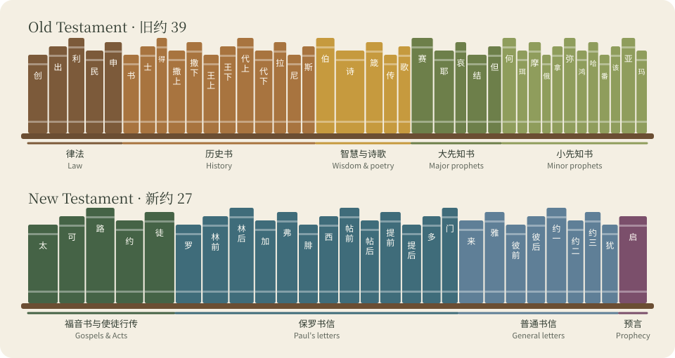
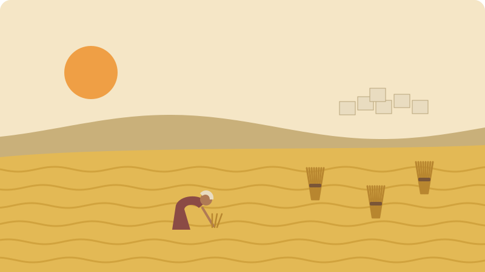

# Bible By Book | 按书卷梳理圣经

> Status: Draft (AI draft; not human reviewed) | 状态：Draft（AI 草稿，未人工审阅）

> **In Three Sentences | 三句话读懂本篇**
>
> Find any of the 66 books in the index and see where it belongs in the larger story. Each profile gives its setting, its main role, and one passage to start with. These are short orientations, not full studies. 
> 在索引中找到 66 卷中的任何一卷，看看它属于故事的哪一部分。每份简介都写明背景、主要作用和一段入门经文。这些只是简短的导引，不是完整的研究。

This page walks through the [Bible](../Glossary/README.md#bible) book by book and shows where each book fits on the larger timeline. 
本页按书卷梳理[圣经](../Glossary/README.md#bible)，并把每卷书放到整条时间线上。

## Book Jump Table | 书卷跳转表

Use the table below to jump straight to any book. For abbreviations and chapter counts, see the [Bible Reading Toolkit](./Bible_Reading_Toolkit_Bilingual.md#book-list). 
用下表可直接跳到任何一卷书。书卷缩写与章数见[读经工具箱](./Bible_Reading_Toolkit_Bilingual.md#book-list)。

| Collection | Books / 书卷 | Jump / 跳转 |
| --- | --- | --- |
| Pentateuch / 摩西五经 | Genesis 创世记 · [Exodus](../Glossary/README.md#exodus) 出埃及记 · Leviticus 利未记 · Numbers 民数记 · Deuteronomy 申命记 | [Genesis](#genesis) · [Exodus](#exodus) · [Leviticus](#leviticus) · [Numbers](#numbers) · [Deuteronomy](#deuteronomy) |
| Historical books / 历史书 | Joshua 约书亚记 · Judges 士师记 · Ruth 路得记 · 1–2 Samuel 撒母耳记上下 · 1–2 Kings 列王纪上下 · 1–2 Chronicles 历代志上下 · Ezra 以斯拉记 · Nehemiah 尼希米记 · Esther 以斯帖记 | [Joshua](#joshua) · [Judges](#judges) · [Ruth](#ruth) · [1 Samuel](#1-samuel) · [2 Samuel](#2-samuel) · [1 Kings](#1-kings) · [2 Kings](#2-kings) · [1 Chronicles](#1-chronicles) · [2 Chronicles](#2-chronicles) · [Ezra](#ezra) · [Nehemiah](#nehemiah) · [Esther](#esther) |
| [Wisdom](../Glossary/README.md#wisdom) and poetry / [智慧](../Glossary/README.md#wisdom)与诗歌 | Job 约伯记 · [Psalms](../Glossary/README.md#psalm) [诗篇](../Glossary/README.md#psalm) · Proverbs 箴言 · Ecclesiastes 传道书 · Song of Songs 雅歌 | [Job](#job) · [Psalms](#psalms) · [Proverbs](#proverbs) · [Ecclesiastes](#ecclesiastes) · [Song of Songs](#song-of-songs) |
| Major prophets / 大先知书 | Isaiah 以赛亚书 · Jeremiah 耶利米书 · Lamentations 耶利米哀歌 · Ezekiel 以西结书 · Daniel 但以理书 | [Isaiah](#isaiah) · [Jeremiah](#jeremiah) · [Lamentations](#lamentations) · [Ezekiel](#ezekiel) · [Daniel](#daniel) |
| Minor prophets / 小先知书 | Hosea 何西阿书 · Joel 约珥书 · Amos 阿摩司书 · Obadiah 俄巴底亚书 · Jonah 约拿书 · Micah 弥迦书 · Nahum 那鸿书 · Habakkuk 哈巴谷书 · Zephaniah 西番雅书 · Haggai 哈该书 · Zechariah 撒迦利亚书 · Malachi 玛拉基书 | [Hosea](#hosea) · [Joel](#joel) · [Amos](#amos) · [Obadiah](#obadiah) · [Jonah](#jonah) · [Micah](#micah) · [Nahum](#nahum) · [Habakkuk](#habakkuk) · [Zephaniah](#zephaniah) · [Haggai](#haggai) · [Zechariah](#zechariah) · [Malachi](#malachi) |
| Gospels and Acts / [福音书](../Glossary/README.md#gospels)与使徒行传 | Matthew 马太福音 · Mark 马可福音 · Luke 路加福音 · John 约翰福音 · Acts 使徒行传 | [Matthew](#matthew) · [Mark](#mark) · [Luke](#luke) · [John](#john) · [Acts](#acts) |
| Paul's letters / 保罗书信 | Romans 罗马书 · 1 Corinthians 哥林多前书 · 2 Corinthians 哥林多后书 · Galatians 加拉太书 · Ephesians 以弗所书 · Philippians 腓立比书 · Colossians 歌罗西书 · 1 Thessalonians 帖撒罗尼迦前书 · 2 Thessalonians 帖撒罗尼迦后书 · 1 Timothy 提摩太前书 · 2 Timothy 提摩太后书 · Titus 提多书 · Philemon 腓利门书 | [Romans](#romans) · [1 Corinthians](#1-corinthians) · [2 Corinthians](#2-corinthians) · [Galatians](#galatians) · [Ephesians](#ephesians) · [Philippians](#philippians) · [Colossians](#colossians) · [1 Thessalonians](#1-thessalonians) · [2 Thessalonians](#2-thessalonians) · [1 Timothy](#1-timothy) · [2 Timothy](#2-timothy) · [Titus](#titus) · [Philemon](#philemon) |
| General letters / 普通书信 | Hebrews 希伯来书 · James 雅各书 · 1 Peter 彼得前书 · 2 Peter 彼得后书 · 1 John 约翰一书 · 2 John 约翰二书 · 3 John 约翰三书 · Jude 犹大书 | [Hebrews](#hebrews) · [James](#james) · [1 Peter](#1-peter) · [2 Peter](#2-peter) · [1 John](#1-john) · [2 John](#2-john) · [3 John](#3-john) · [Jude](#jude) |
| Revelation / 启示录 | Revelation 启示录 | [Revelation](#revelation) |

*Original illustration for this library; not historical evidence. / 本资料库原创插画，不作为历史证据。* [About the illustrations | 插画说明](../CREDITS.md#original-illustrations)

[Back to Bible Timeline Research Hub / 返回圣经时间线研究导航](./README.md)

## How To Use This File | 怎么使用这份文件

Use this file when your question is not only “what happened next?” but also “why is this book here?” or “what role does this book play in the whole Bible?” 
当你的问题不只是“接下来发生了什么”，而是“这卷书为什么在这里”或“这卷书在整本圣经里扮演什么角色”时，就用这份文件。

## Pentateuch | 摩西五经

### Genesis | 创世记

- **Timeline placement:** [creation](../Glossary/README.md#creation), fall, flood, Babel, patriarchs.
  **时间位置：**[创造](../Glossary/README.md#creation)、堕落、洪水、巴别、列祖时期。
- **Main role:** establishes the beginning of the world, the entrance of sin, and the [covenant](../Glossary/README.md#covenant) promise line through Abraham's family.
  **主要作用：**交代世界起头、罪如何进入历史，以及神如何借着亚伯拉罕家族建立[应许](../Glossary/README.md#promise)主线。
- **Start with:** Genesis 12:1–9 — God calls Abram and promises that all nations will be blessed through his family.
  **先读：**创世记 12:1–9——神呼召亚伯兰，应许地上万族都要因他的家族得福。

*Original illustration for this library; not historical evidence. / 本资料库原创插画，不作为历史证据。* [About the illustrations | 插画说明](../CREDITS.md#original-illustrations)

### Exodus | 出埃及记

- **Timeline placement:** Egypt, exodus, Sinai.
  **时间位置：**埃及、[出埃及](../Glossary/README.md#exodus)、西奈时期。
- **Main role:** shows God rescuing his people from slavery and binding them to himself in covenant.
  **主要作用：**显明神怎样把祂的百姓从奴役中救出来，并与他们[立约](../Glossary/README.md#covenant)。
- **Start with:** Exodus 3:1–15 — At the burning bush, God reveals his name and sends Moses to free Israel.
  **先读：**出埃及记 3:1–15——神在燃烧的荆棘中启示自己的名，差派摩西拯救以色列。

*Original illustration for this library; not historical evidence. / 本资料库原创插画，不作为历史证据。* [About the illustrations | 插画说明](../CREDITS.md#original-illustrations)

### Leviticus | 利未记

- **Timeline placement:** Sinai period.
  **时间位置：**西奈时期。
- **Main role:** explains holiness, [sacrifice](../Glossary/README.md#sacrifice), priesthood, cleanness, and how a holy God dwells among a sinful people.
  **主要作用：**解释圣洁、[献祭](../Glossary/README.md#sacrifice)、[祭司](../Glossary/README.md#priest)、洁净，以及圣洁的神如何住在有罪的人中间。
- **Start with:** Leviticus 19:1–18 — Holiness reaches daily life, ending with “love your neighbor as yourself.”
  **先读：**利未记 19:1–18——圣洁落实到日常生活，并以“爱人如己”作结。

*Original illustration for this library; not historical evidence. / 本资料库原创插画，不作为历史证据。* [About the illustrations | 插画说明](../CREDITS.md#original-illustrations)

### Numbers | 民数记

- **Timeline placement:** wilderness wandering.
  **时间位置：**旷野漂流。
- **Main role:** records [Israel](../Glossary/README.md#israel)'s rebellion, judgment, preservation, and continued movement toward the land.
  **主要作用：**记载[以色列](../Glossary/README.md#israel)的悖逆、审判、蒙保守，以及继续走向应许之地的过程。
- **Start with:** Numbers 13:25–14:9 — The spies' report shows fear and trust at the edge of the promised land.
  **先读：**民数记 13:25–14:9——探子的报告显出人在应许之地门口的惧怕与信靠。

### Deuteronomy | 申命记

- **Timeline placement:** plains of Moab before entering Canaan.
  **时间位置：**进入迦南前的摩押平原。
- **Main role:** Moses renews covenant instruction for a new generation about to enter the land.
  **主要作用：**摩西向新一代重申约的教导，为进地作准备。
- **Start with:** Deuteronomy 6:1–9 — The call to love God with all your heart and to teach it at home.
  **先读：**申命记 6:1–9——呼召人尽心爱神，并在家中把这话教导下一代。

*Original illustration for this library; not historical evidence. / 本资料库原创插画，不作为历史证据。* [About the illustrations | 插画说明](../CREDITS.md#original-illustrations)

## Historical Books | 历史书

### Joshua | 约书亚记

- **Timeline placement:** conquest and initial settlement.
  **时间位置：**征服与初步得地。
- **Main role:** Israel enters and begins to possess the land promised to Abraham.
  **主要作用：**以色列进入并开始得着应许给亚伯拉罕的土地。
- **Start with:** Joshua 1:1–9 — God commissions Joshua: be strong and courageous, and keep the law close.
  **先读：**约书亚记 1:1–9——神差派约书亚：要刚强壮胆，常常默想律法。

*Original illustration for this library; not historical evidence. / 本资料库原创插画，不作为历史证据。* [About the illustrations | 插画说明](../CREDITS.md#original-illustrations)

### Judges | 士师记

- **Timeline placement:** pre-monarchy period.
  **时间位置：**君王制度建立前。
- **Main role:** shows repeated cycles of sin, oppression, crying out, and deliverance.
  **主要作用：**显明“犯罪、受压、呼求、拯救”的反复循环。
- **Start with:** Judges 2:6–19 — A summary of the book's repeating cycle of turning away and rescue.
  **先读：**士师记 2:6–19——概括全书“离弃神—受压—得救”的反复循环。

### Ruth | 路得记

- **Timeline placement:** time of the judges.
  **时间位置：**士师时期。
- **Main role:** shows God's quiet faithfulness in ordinary lives and prepares the family line that leads to David.
  **主要作用：**显明神在平凡生活中默默而真实的信实，并引出通向大卫的家谱。
- **Start with:** Ruth 1:1–18 — Ruth chooses to stay with Naomi and with Naomi's God.
  **先读：**路得记 1:1–18——路得决定跟随拿俄米，也跟随拿俄米的神。

*Original illustration for this library; not historical evidence. / 本资料库原创插画，不作为历史证据。* [About the illustrations | 插画说明](../CREDITS.md#original-illustrations)

### 1 Samuel | 撒母耳记上

- **Timeline placement:** transition from judges to kings.
  **时间位置：**从士师时代过渡到君王时代。
- **Main role:** records Samuel, Saul, and the rise of David.
  **主要作用：**记载撒母耳、扫罗与大卫的兴起。
- **Start with:** 1 Samuel 16:1–13 — God chooses young David, looking at the heart rather than appearance.
  **先读：**撒母耳记上 16:1–13——神拣选年轻的大卫；人看外貌，神看内心。

*Original illustration for this library; not historical evidence. / 本资料库原创插画，不作为历史证据。* [About the illustrations | 插画说明](../CREDITS.md#original-illustrations)

### 2 Samuel | 撒母耳记下

- **Timeline placement:** reign of David.
  **时间位置：**大卫作王时期。
- **Main role:** centers on David's kingship, failures, and the covenant [promise](../Glossary/README.md#promise) of an enduring throne.
  **主要作用：**集中记载大卫王权、他的失败，以及神对大卫之约的应许。
- **Start with:** 2 Samuel 7:1–17 — God promises David a lasting house and throne.
  **先读：**撒母耳记下 7:1–17——神应许为大卫建立永远的家和王位。

### 1 Kings | 列王纪上

- **Timeline placement:** Solomon and the beginning of the divided kingdom.
  **时间位置：**所罗门时期与王国分裂开端。
- **Main role:** shows glory under Solomon and decline through idolatry and division.
  **主要作用：**显明所罗门时期的荣耀，也显明偶像崇拜和分裂带来的衰败。
- **Start with:** 1 Kings 18:20–39 — Elijah on Mount Carmel calls Israel to choose whom they will follow.
  **先读：**列王纪上 18:20–39——以利亚在迦密山呼召以色列选择跟随谁。

*Original illustration for this library; not historical evidence. / 本资料库原创插画，不作为历史证据。* [About the illustrations | 插画说明](../CREDITS.md#original-illustrations)

### 2 Kings | 列王纪下

- **Timeline placement:** divided kingdom to [exile](../Glossary/README.md#exile).
  **时间位置：**分裂王国直到[被掳](../Glossary/README.md#exile)。
- **Main role:** traces the collapse of Israel and [Judah](../Glossary/README.md#judah) into exile.
  **主要作用：**追踪北国与南国如何一步步走向被掳。
- **Start with:** 2 Kings 17:6–18 — The book explains why the northern kingdom fell to Assyria.
  **先读：**列王纪下 17:6–18——书卷解释北国以色列为何被亚述所灭。

*Original illustration for this library; not historical evidence. / 本资料库原创插画，不作为历史证据。* [About the illustrations | 插画说明](../CREDITS.md#original-illustrations)

### 1 Chronicles | 历代志上

- **Timeline placement:** focuses on David's reign; written after the return from exile.
  **时间位置：**内容聚焦大卫作王时期，成书于被掳归回之后。
- **Main role:** retells Israel's history to returned exiles, highlighting David, worship, preparation for the [temple](../Glossary/README.md#temple), and the people's identity before God.
  **主要作用：**向归回的群体重新讲述以色列历史，突出大卫、敬拜、[圣殿](../Glossary/README.md#temple)的预备，以及百姓在神面前的身份。
- **Start with:** 1 Chronicles 29:10–19 — David's prayer of praise as materials are gathered for the temple.
  **先读：**历代志上 29:10–19——大卫为建殿预备材料时献上的赞美祷告。

### 2 Chronicles | 历代志下

- **Timeline placement:** Solomon through exile and the return decree.
  **时间位置：**从所罗门直到被掳和归回诏令。
- **Main role:** retells Judah's history with focus on temple, kings, reform, and covenant faithfulness.
  **主要作用：**从圣殿、君王、改革和守约角度重述犹大的历史。
- **Start with:** 2 Chronicles 36:15–23 — Exile, then Cyrus's decree that opens the way home.
  **先读：**历代志下 36:15–23——从被掳到古列下诏，为归回打开道路。

*Original illustration for this library; not historical evidence. / 本资料库原创插画，不作为历史证据。* [About the illustrations | 插画说明](../CREDITS.md#original-illustrations)

### Ezra | 以斯拉记

- **Timeline placement:** after [return from exile](../Glossary/README.md#return).
  **时间位置：**[被掳归回](../Glossary/README.md#return)之后。
- **Main role:** records the rebuilding of the temple and the community's return to a life shaped by the [Torah](../Glossary/README.md#law).
  **主要作用：**记载圣殿重建，以及群体重新以[律法](../Glossary/README.md#law)塑造生活。
- **Start with:** Ezra 3:8–13 — The temple's foundation is laid with both shouts of joy and weeping.
  **先读：**以斯拉记 3:8–13——圣殿根基立定时，欢呼声与哭声交织。

### Nehemiah | 尼希米记

- **Timeline placement:** post-exilic rebuilding.
  **时间位置：**被掳后重建阶段。
- **Main role:** records the rebuilding of Jerusalem's walls, the renewal of the covenant, and reforms in community life.
  **主要作用：**记载耶路撒冷城墙的重建、立约的更新，以及群体生活的整顿。
- **Start with:** Nehemiah 8:1–12 — The people gather to hear the law read and explained.
  **先读：**尼希米记 8:1–12——百姓聚集，听人宣读并讲解律法。

*Original illustration for this library; not historical evidence. / 本资料库原创插画，不作为历史证据。* [About the illustrations | 插画说明](../CREDITS.md#original-illustrations)

### Esther | 以斯帖记

- **Timeline placement:** Persian period.
  **时间位置：**波斯时期。
- **Main role:** shows God's providential preservation of his people in exile, even when his name is not explicitly mentioned.
  **主要作用：**显明神怎样在被掳散居之中保守祂的百姓，即使书中没有直接提到神的名。
- **Start with:** Esther 4:1–17 — Mordecai and Esther face a deadly decree: “for such a time as this.”
  **先读：**以斯帖记 4:1–17——面对灭族的诏令，末底改与以斯帖说出“现今的机会”。

*Original illustration for this library; not historical evidence. / 本资料库原创插画，不作为历史证据。* [About the illustrations | 插画说明](../CREDITS.md#original-illustrations)

## Wisdom and Poetry | 智慧文学与诗歌

### Job | 约伯记

- **Timeline placement:** difficult to date precisely; often grouped with wisdom literature.
  **时间位置：**很难精确定位；通常归在智慧文学中理解。
- **Main role:** wrestles with suffering, why the righteous suffer, and the mystery of God's wisdom.
  **主要作用：**探讨苦难、义人为何受苦，以及神智慧的奥秘。
- **Start with:** Job 38:1–18 — God answers Job out of the whirlwind with questions about creation.
  **先读：**约伯记 38:1–18——神从旋风中回答约伯，以创造之事向他发问。

*Original illustration for this library; not historical evidence. / 本资料库原创插画，不作为历史证据。* [About the illustrations | 插画说明](../CREDITS.md#original-illustrations)

### Psalms | 诗篇

- **Timeline placement:** written across many periods.
  **时间位置：**跨越很多时期写成。
- **Main role:** serves as the prayer book and songbook of God's people, with praise, thanks, and honest lament.
  **主要作用：**是神子民的祷告书与诗歌集，有赞美、感恩，也有坦诚的哀诉。
- **Start with:** Psalm 23 — The best-known psalm of trust: the LORD as shepherd and host.
  **先读：**诗篇 23 篇——最广为人知的信靠诗：耶和华是牧者，也是摆设筵席的主人。

*Original illustration for this library; not historical evidence. / 本资料库原创插画，不作为历史证据。* [About the illustrations | 插画说明](../CREDITS.md#original-illustrations)

### Proverbs | 箴言

- **Timeline placement:** linked mainly with Solomon, with collections gathered over time.
  **时间位置：**主要与所罗门有关，并经过后来多次汇编。
- **Main role:** teaches wisdom for daily life under the fear of the Lord.
  **主要作用：**教导人如何在敬畏耶和华中活出日常智慧。
- **Start with:** Proverbs 3:1–12 — Trust the LORD with all your heart and do not lean on your own understanding.
  **先读：**箴言 3:1–12——要专心仰赖耶和华，不可倚靠自己的聪明。

### Ecclesiastes | 传道书

- **Timeline placement:** wisdom tradition, often linked with Solomon.
  **时间位置：**智慧传统中，常与所罗门联系。
- **Main role:** exposes the emptiness of life lived “under the sun” apart from God.
  **主要作用：**揭露离开神、只在“日光之下”寻找意义的人生虚空。
- **Start with:** Ecclesiastes 3:1–15 — A time for everything, and life received as God's gift.
  **先读：**传道书 3:1–15——凡事都有定时；人生是神所赐的礼物。

*Original illustration for this library; not historical evidence. / 本资料库原创插画，不作为历史证据。* [About the illustrations | 插画说明](../CREDITS.md#original-illustrations)

### Song of Songs | 雅歌

- **Timeline placement:** part of the wisdom and poetry tradition; its date is debated.
  **时间位置：**属于智慧与诗歌传统；成书年代有争议。
- **Main role:** celebrates love, desire, and delight between a bride and groom; many readers have also heard in it echoes of God's love for his people.
  **主要作用：**歌颂新娘与新郎之间的爱情、渴慕与喜悦；历代许多读者也从中读出神与子民之间的爱。
- **Start with:** Song of Songs 8:6–7 — Love that is as strong as death and that many waters cannot quench.
  **先读：**雅歌 8:6–7——爱情如死之坚强，众水不能熄灭。

## Major Prophets | 大先知书

### Isaiah | 以赛亚书

- **Timeline placement:** Isaiah's ministry in Judah in the eighth century BC; the later chapters speak to exile and return, and how they were composed is debated.
  **时间位置：**以赛亚在主前八世纪于犹大事奉；后半部分面向被掳与归回的处境，其成书方式有争议。
- **Main role:** announces judgment, holiness, the coming king, servant, and future restoration.
  **主要作用：**宣告审判、圣洁、将来的王、受苦仆人以及恢复。
- **Start with:** Isaiah 52:13–53:12 — The servant who suffers for others, a passage the New Testament applies to Jesus.
  **先读：**以赛亚书 52:13–53:12——为众人受苦的仆人；新约把这段经文应用在耶稣身上。

*Original illustration for this library; not historical evidence. / 本资料库原创插画，不作为历史证据。* [About the illustrations | 插画说明](../CREDITS.md#original-illustrations)

### Jeremiah | 耶利米书

- **Timeline placement:** last days of Judah and beginning of exile.
  **时间位置：**犹大末期与被掳开端。
- **Main role:** warns of coming judgment and promises a new covenant written on the heart.
  **主要作用：**警告将临的审判，并应许神要另立新约，把律法写在人心上。
- **Start with:** Jeremiah 31:31–34 — God promises a new covenant written on the heart.
  **先读：**耶利米书 31:31–34——神应许要另立新约，把律法写在人心上。

*Original illustration for this library; not historical evidence. / 本资料库原创插画，不作为历史证据。* [About the illustrations | 插画说明](../CREDITS.md#original-illustrations)

### Lamentations | 耶利米哀歌

- **Timeline placement:** after Jerusalem's fall.
  **时间位置：**耶路撒冷陷落之后。
- **Main role:** mourns the destruction of Jerusalem and teaches covenant grief before God.
  **主要作用：**为耶路撒冷的毁灭哀哭，并教人怎样在约中向神哀求。
- **Start with:** Lamentations 3:19–33 — In the middle of grief, the writer still confesses that God's mercies are new every morning.
  **先读：**耶利米哀歌 3:19–33——在哀伤之中仍承认：神的怜悯每早晨都是新的。

*Original illustration for this library; not historical evidence. / 本资料库原创插画，不作为历史证据。* [About the illustrations | 插画说明](../CREDITS.md#original-illustrations)

### Ezekiel | 以西结书

- **Timeline placement:** during exile.
  **时间位置：**被掳期间。
- **Main role:** announces judgment, shows God's glory present even in exile, and promises a new heart and a restored people.
  **主要作用：**宣告审判，显明神的荣耀在被掳之地也同在，并应许赐人新心、恢复祂的子民。
- **Start with:** Ezekiel 37:1–14 — The valley of dry bones: God can bring his people back to life.
  **先读：**以西结书 37:1–14——枯骨复生的异象：神能使祂的子民重新活过来。

*Original illustration for this library; not historical evidence. / 本资料库原创插画，不作为历史证据。* [About the illustrations | 插画说明](../CREDITS.md#original-illustrations)

### Daniel | 但以理书

- **Timeline placement:** exile and imperial courts.
  **时间位置：**被掳与外邦帝国宫廷时期。
- **Main role:** shows faithfulness in exile and God's sovereignty over kingdoms.
  **主要作用：**显明在被掳中如何忠心，并显明神高过万国政权的主权。
- **Start with:** Daniel 6:10–23 — Daniel keeps praying under threat and is kept safe in the lions' den.
  **先读：**但以理书 6:10–23——但以理在威胁下照常祷告，在狮子坑中蒙保守。

*Original illustration for this library; not historical evidence. / 本资料库原创插画，不作为历史证据。* [About the illustrations | 插画说明](../CREDITS.md#original-illustrations)

## Minor Prophets | 小先知书

### Minor Prophets: Twelve Short Books | 小先知书：十二卷短书

“Minor” refers to length, not importance. In Hebrew Bibles these twelve books form a single scroll, “the Book of the Twelve.” Together they announce judgment, call for repentance, and keep hope alive before exile, during it, and after the return. 
“小”是指篇幅短，而不是不重要。在希伯来圣经中，这十二卷合为一卷，称为“十二先知书”。它们在被掳前、被掳中和归回后，一同宣告审判、呼召悔改、守住盼望。

### Hosea | 何西阿书

- **Timeline placement:** the northern kingdom of Israel in the eighth century BC, before its fall to Assyria in 722 BC.
  **时间位置：**主前八世纪的北国以色列，在 722 年被亚述攻陷之前。
- **Main role:** Hosea's marriage to an unfaithful wife becomes a living picture of Israel's unfaithfulness and of God's love that will not let go.
  **主要作用：**何西阿与不忠之妻的婚姻，成为以色列不忠的写照，也显出神不肯放手的爱。
- **Start with:** Hosea 11:1–11 — God speaks as a parent who taught Israel to walk and cannot give them up.
  **先读：**何西阿书 11:1–11——神像父母一样说话：曾教以色列学步，如今不忍舍弃他们。

### Joel | 约珥书

- **Timeline placement:** uncertain; scholars suggest dates from before the exile to after the return.
  **时间位置：**不确定；学者提出的年代从被掳前到归回后都有。
- **Main role:** uses a devastating locust plague to call the people to return to God, and promises that God's Spirit will be poured out on all people.
  **主要作用：**借一场严重的蝗灾呼召百姓归向神，并应许神要把祂的灵浇灌凡有血气的。
- **Start with:** Joel 2:12–32 — “Return to me with all your heart,” and the promise Peter quotes at Pentecost (Acts 2).
  **先读：**约珥书 2:12–32——“你们应当一心归向我”，以及彼得在五旬节引用的应许（使徒行传 2 章）。

### Amos | 阿摩司书

- **Timeline placement:** the prosperous northern kingdom in the mid-eighth century BC.
  **时间位置：**主前八世纪中叶、经济繁荣的北国以色列。
- **Main role:** a shepherd from Judah confronts Israel's comfortable worship that ignores injustice toward the poor.
  **主要作用：**一位来自犹大的牧人，直斥以色列安逸的宗教生活，却无视对穷人的不公。
- **Start with:** Amos 5:14–24 — “Let justice roll down like waters.”
  **先读：**阿摩司书 5:14–24——“惟愿公平如大水滚滚。”

### Obadiah | 俄巴底亚书

- **Timeline placement:** probably after Jerusalem fell to Babylon in 586 BC, though the date is debated.
  **时间位置：**可能在 586 年耶路撒冷被巴比伦攻陷之后，但年代有争议。
- **Main role:** the Old Testament's shortest book announces judgment on Edom for gloating over and joining in Judah's disaster.
  **主要作用：**旧约最短的一卷书，宣告以东因幸灾乐祸、趁火打劫犹大而要受审判。
- **Start with:** Obadiah 10–15 — The charge against Edom, and the warning that what you do will return on your head.
  **先读：**俄巴底亚书 10–15 节——对以东的控诉，以及“你怎样行，也必照样受报”的警告。

### Jonah | 约拿书

- **Timeline placement:** set in the eighth century BC (compare 2 Kings 14:25), when Assyria was Israel's feared enemy.
  **时间位置：**故事背景在主前八世纪（参列王纪下 14:25），当时亚述是以色列所惧怕的敌人。
- **Main role:** a reluctant prophet runs from God's call, yet God shows mercy to sailors, to Nineveh, and to Jonah himself.
  **主要作用：**一位不情愿的先知逃避神的呼召，但神向水手、向尼尼微城，也向约拿本人显出怜悯。
- **Start with:** Jonah 3:10–4:11 — God spares Nineveh and gently questions Jonah's anger.
  **先读：**约拿书 3:10–4:11——神宽免尼尼微，并温和地追问约拿为何发怒。

*Original illustration for this library; not historical evidence. / 本资料库原创插画，不作为历史证据。* [About the illustrations | 插画说明](../CREDITS.md#original-illustrations)

### Micah | 弥迦书

- **Timeline placement:** Judah in the late eighth century BC, in the same era as Isaiah.
  **时间位置：**主前八世纪末的犹大，与以赛亚同一时代。
- **Main role:** condemns corrupt leaders and empty ritual, and promises a ruler from Bethlehem who will shepherd God's people.
  **主要作用：**谴责腐败的领袖与空洞的礼仪，并应许有一位出自伯利恒的掌权者要牧养神的子民。
- **Start with:** Micah 6:1–8 — “Do justice, love kindness, and walk humbly with your God.”
  **先读：**弥迦书 6:1–8——“行公义，好怜悯，存谦卑的心，与你的神同行。”

### Nahum | 那鸿书

- **Timeline placement:** late seventh century BC, before Nineveh fell in 612 BC.
  **时间位置：**主前七世纪末，尼尼微于 612 年陷落之前。
- **Main role:** announces the fall of cruel Assyria; read alongside Jonah, it shows that God's patience does not mean indifference to violence.
  **主要作用：**宣告残暴的亚述必然倾覆；和约拿书对照来读，可见神的忍耐并不等于对暴行漠不关心。
- **Start with:** Nahum 1:1–8 — The LORD is slow to anger, yet a refuge for those who trust him.
  **先读：**那鸿书 1:1–8——耶和华不轻易发怒，又是投靠祂之人的避难所。

### Habakkuk | 哈巴谷书

- **Timeline placement:** late seventh century BC, as Babylon rose to power.
  **时间位置：**主前七世纪末，巴比伦正在兴起。
- **Main role:** a prophet brings honest questions to God about injustice and learns to wait and trust; “the righteous shall live by faith.”
  **主要作用：**先知把对不公义的困惑坦白地带到神面前，学会等候与信靠：“义人因信得生。”
- **Start with:** Habakkuk 3:17–19 — A song of trust even when the fields fail.
  **先读：**哈巴谷书 3:17–19——即使田地没有出产，仍要靠神喜乐的信心之歌。

### Zephaniah | 西番雅书

- **Timeline placement:** the reign of King Josiah of Judah, in the late seventh century BC (Zephaniah 1:1).
  **时间位置：**主前七世纪末犹大王约西亚在位期间（西番雅书 1:1）。
- **Main role:** warns of the coming day of the LORD and ends with God rejoicing over a humble, restored people.
  **主要作用：**警告耶和华的日子临近，最后以神因谦卑、得复兴的子民而欢喜作结。
- **Start with:** Zephaniah 3:14–20 — God “will rejoice over you with singing.”
  **先读：**西番雅书 3:14–20——神“且因你喜乐而欢呼”。

### Haggai | 哈该书

- **Timeline placement:** 520 BC, after some exiles had returned to Jerusalem.
  **时间位置：**主前 520 年，部分被掳者已回到耶路撒冷。
- **Main role:** urges the returned community to stop putting off the rebuilding of the temple and promises God's presence with them.
  **主要作用：**催促归回的群体不要再拖延重建圣殿，并应许神与他们同在。
- **Start with:** Haggai 1:1–15 — “Consider your ways,” and the people respond and begin to build.
  **先读：**哈该书 1:1–15——“你们要省察自己的行为”，百姓回应，开始动工。

*Original illustration for this library; not historical evidence. / 本资料库原创插画，不作为历史证据。* [About the illustrations | 插画说明](../CREDITS.md#original-illustrations)

### Zechariah | 撒迦利亚书

- **Timeline placement:** from 520 BC onward, the same rebuilding period as Haggai.
  **时间位置：**从主前 520 年起，与哈该同属重建时期。
- **Main role:** uses visions to encourage the rebuilders and looks ahead to a humble king coming to Jerusalem.
  **主要作用：**借一系列异象鼓励重建的百姓，并展望一位谦和的王要进入耶路撒冷。
- **Start with:** Zechariah 9:9–10 — The king who comes “humble and riding on a donkey,” recalled when Jesus enters Jerusalem.
  **先读：**撒迦利亚书 9:9–10——那位“谦谦和和地骑着驴”而来的王；福音书在耶稣进耶路撒冷时引用此处。

### Malachi | 玛拉基书

- **Timeline placement:** the fifth century BC, some decades after the temple was rebuilt.
  **时间位置：**主前五世纪，圣殿重建后数十年。
- **Main role:** challenges careless worship and broken marriage vows, and announces a messenger who will prepare the way for the Lord.
  **主要作用：**指出敷衍的敬拜与背信的婚姻，并宣告有一位使者要为主预备道路。
- **Start with:** Malachi 3:1–4; 4:4–6 — The promised messenger and Elijah, whom the Gospels connect with John the Baptist.
  **先读：**玛拉基书 3:1–4；4:4–6——应许中的使者与以利亚；福音书把他与施洗约翰联系起来。

*Original illustration for this library; not historical evidence. / 本资料库原创插画，不作为历史证据。* [About the illustrations | 插画说明](../CREDITS.md#original-illustrations)

## Gospels and Acts | 福音书与使徒行传

### Matthew | 马太福音

- **Timeline placement:** life of Jesus.
  **时间位置：**耶稣在世事工时期。
- **Main role:** presents Jesus as the promised [Messiah](../Glossary/README.md#messiah) who fulfills the Old Testament Scriptures.
  **主要作用：**强调耶稣是应许中的[弥赛亚](../Glossary/README.md#messiah)，应验了旧约经文。
- **Start with:** Matthew 5:1–16 — The opening of the Sermon on the Mount: the Beatitudes, salt and light.
  **先读：**马太福音 5:1–16——登山宝训的开头：八福、盐和光。

*Original illustration for this library; not historical evidence. / 本资料库原创插画，不作为历史证据。* [About the illustrations | 插画说明](../CREDITS.md#original-illustrations)

### Mark | 马可福音

- **Timeline placement:** life of Jesus.
  **时间位置：**耶稣在世事工时期。
- **Main role:** tells Jesus' story with urgency, showing his authority in action and his path toward the cross.
  **主要作用：**以紧凑的节奏讲述耶稣，展现祂在行动中的权柄，以及走向十字架的道路。
- **Start with:** Mark 8:27–38 — “Who do you say I am?” and the call to take up the cross.
  **先读：**马可福音 8:27–38——“你们说我是谁？”以及背起十字架的呼召。

*Original illustration for this library; not historical evidence. / 本资料库原创插画，不作为历史证据。* [About the illustrations | 插画说明](../CREDITS.md#original-illustrations)

### Luke | 路加福音

- **Timeline placement:** life of Jesus.
  **时间位置：**耶稣在世事工时期。
- **Main role:** gives an orderly account with special attention to history, mercy, prayer, outsiders, and [salvation](../Glossary/README.md#salvation).
  **主要作用：**有条理地讲述耶稣的生平，特别关注历史背景、怜悯、祷告、被边缘化的人和[救恩](../Glossary/README.md#salvation)。
- **Start with:** Luke 15:11–32 — The parable of the lost son and the waiting father.
  **先读：**路加福音 15:11–32——浪子与等候他回家的父亲的比喻。

### John | 约翰福音

- **Timeline placement:** life of Jesus.
  **时间位置：**耶稣在世事工时期。
- **Main role:** emphasizes Jesus' identity as the Son who reveals the Father and gives eternal life.
  **主要作用：**强调耶稣是启示父神、赐永生的圣子。
- **Start with:** John 1:1–18 — The Word who was with God becomes flesh and lives among us.
  **先读：**约翰福音 1:1–18——太初与神同在的道成了肉身，住在我们中间。

*Original illustration for this library; not historical evidence. / 本资料库原创插画，不作为历史证据。* [About the illustrations | 插画说明](../CREDITS.md#original-illustrations)

### Acts | 使徒行传

- **Timeline placement:** after [resurrection](../Glossary/README.md#resurrection) and ascension.
  **时间位置：**[复活](../Glossary/README.md#resurrection)、升天之后。
- **Main role:** records the Spirit's work in the early [church](../Glossary/README.md#church) and the spread of the [gospel](../Glossary/README.md#gospel) from Jerusalem outward.
  **主要作用：**记载[圣灵](../Glossary/README.md#holy-spirit)在初代[教会](../Glossary/README.md#church)中的工作，以及福音从耶路撒冷向外扩展。
- **Start with:** Acts 2:36–47 — After Pentecost, the first church forms around teaching, meals, and prayer.
  **先读：**使徒行传 2:36–47——五旬节后，第一批信徒在教导、擘饼和祷告中形成群体。

*Original illustration for this library; not historical evidence. / 本资料库原创插画，不作为历史证据。* [About the illustrations | 插画说明](../CREDITS.md#original-illustrations)

## Letters | 新约书信

### Paul's Letters: Thirteen Letters | 保罗书信：十三封信

These letters carry Paul's name and were written to churches or coworkers during the first decades of the church. They explain the gospel and apply it to real problems. Scholars debate whether Paul personally wrote some of them; this guide notes those debates where they matter. 
这些书信都署名保罗，写于教会最初的几十年间，收信人是教会或同工。它们解释福音，并把福音应用到具体问题上。学者对其中几封是否由保罗亲笔有争议；本导读会在相关处注明。

*Original illustration for this library; not historical evidence. / 本资料库原创插画，不作为历史证据。* [About the illustrations | 插画说明](../CREDITS.md#original-illustrations)

### Romans | 罗马书

- **Timeline placement:** written to the church in Rome around AD 57, before Paul's first visit there.
  **时间位置：**约公元 57 年写给罗马教会，当时保罗还未去过罗马。
- **Main role:** Paul's fullest explanation of the [gospel](../Glossary/README.md#gospel): all have sinned, God puts people right through faith in Christ, and Jews and Gentiles belong together.
  **主要作用：**保罗对[福音](../Glossary/README.md#gospel)最完整的阐述：世人都犯了罪，神借着信基督使人称义，犹太人与外邦人同属一家。
- **Start with:** Romans 5:1–11 — Peace with God and hope that does not disappoint.
  **先读：**罗马书 5:1–11——与神相和，并且盼望不至于羞耻。

### 1 Corinthians | 哥林多前书

- **Timeline placement:** written from Ephesus in the mid-50s AD to a gifted but divided church.
  **时间位置：**公元 50 年代中期从以弗所写给一间恩赐丰富却彼此分裂的教会。
- **Main role:** addresses divisions, sexual ethics, worship, spiritual gifts, and the resurrection, all under the way of love.
  **主要作用：**处理分党、性伦理、聚会敬拜、属灵恩赐与复活等问题，并以爱为最妙的道路。
- **Start with:** 1 Corinthians 13 — “Love is patient, love is kind.”
  **先读：**哥林多前书 13 章——“爱是恒久忍耐，又有恩慈。”

### 2 Corinthians | 哥林多后书

- **Timeline placement:** written soon after 1 Corinthians, during a strained relationship with the same church.
  **时间位置：**写于哥林多前书之后不久，当时保罗与这间教会的关系紧张。
- **Main role:** Paul defends his ministry by pointing to weakness through which God's power works, and encourages generous giving.
  **主要作用：**保罗为自己的事奉辩护，指出神的能力在人的软弱上显得完全，并劝勉信徒慷慨奉献。
- **Start with:** 2 Corinthians 4:1–18 — Treasure in jars of clay, and hope that does not lose heart.
  **先读：**哥林多后书 4:1–18——宝贝放在瓦器里；我们不丧胆。

*Original illustration for this library; not historical evidence. / 本资料库原创插画，不作为历史证据。* [About the illustrations | 插画说明](../CREDITS.md#original-illustrations)

### Galatians | 加拉太书

- **Timeline placement:** written to churches in Galatia; the date is debated, from the late 40s to the mid-50s AD.
  **时间位置：**写给加拉太地区的众教会；年代有争议，约在公元 40 年代末至 50 年代中期。
- **Main role:** insists that Gentile believers belong to God's people through faith in Christ, without first adopting the Jewish law, and describes freedom lived by the Spirit.
  **主要作用：**坚持外邦信徒因信基督就属于神的子民，不必先守犹太律法，并描述靠圣灵而活的自由。
- **Start with:** Galatians 5:1, 13–26 — Freedom for love, and the fruit of the Spirit.
  **先读：**加拉太书 5:1, 13–26——自由是为了彼此相爱，以及圣灵所结的果子。

### Ephesians | 以弗所书

- **Timeline placement:** one of the letters Paul wrote while imprisoned; its exact setting and recipients are discussed.
  **时间位置：**保罗被囚期间所写的书信之一；具体背景与收信对象仍有讨论。
- **Main role:** celebrates God's plan to unite all things in Christ and to make Jews and Gentiles one body, then shows what that unity looks like at home and in the church.
  **主要作用：**颂赞神要在基督里使万有同归于一、使犹太人与外邦人成为一个身体的计划，再说明这份合一在家庭与教会中的样子。
- **Start with:** Ephesians 2:1–22 — Saved by grace, and the wall between peoples torn down.
  **先读：**以弗所书 2:1–22——得救是本乎恩，拆毁中间隔断的墙。

### Philippians | 腓立比书

- **Timeline placement:** written from prison to a church Paul loved in Philippi.
  **时间位置：**保罗在狱中写给他所挚爱的腓立比教会。
- **Main role:** a warm letter of joy and partnership that holds up Christ's humility as the pattern for life together.
  **主要作用：**一封充满喜乐与同工情谊的书信，以基督的谦卑作为彼此相处的榜样。
- **Start with:** Philippians 2:1–11 — Christ empties himself, and God exalts him.
  **先读：**腓立比书 2:1–11——基督虚己，神将祂升为至高。

### Colossians | 歌罗西书

- **Timeline placement:** written from prison to a church Paul had not founded himself.
  **时间位置：**保罗在狱中写给一间并非由他亲自建立的教会。
- **Main role:** shows that Christ is supreme over all creation, so believers need no extra rituals or secret knowledge to be complete.
  **主要作用：**表明基督超乎一切受造之物，所以信徒不需要额外的仪式或秘传的知识，在祂里面就已完全。
- **Start with:** Colossians 1:15–23 — A hymn to Christ, the image of the invisible God.
  **先读：**歌罗西书 1:15–23——一首颂赞基督的诗：祂是那不能看见之神的像。

### 1 Thessalonians | 帖撒罗尼迦前书

- **Timeline placement:** around AD 50, probably one of Paul's earliest letters, to a young church under pressure.
  **时间位置：**约公元 50 年，可能是保罗最早的书信之一，写给一间在压力中的年轻教会。
- **Main role:** encourages new believers, teaches holy living, and comforts them with the hope of Jesus' return.
  **主要作用：**鼓励初信的信徒，教导圣洁的生活，并以耶稣再来的盼望安慰他们。
- **Start with:** 1 Thessalonians 4:13–18 — Comfort for those grieving believers who have died.
  **先读：**帖撒罗尼迦前书 4:13–18——安慰那些为已离世信徒忧伤的人。

### 2 Thessalonians | 帖撒罗尼迦后书

- **Timeline placement:** written to the same church soon after the first letter.
  **时间位置：**在第一封信之后不久写给同一间教会。
- **Main role:** corrects the idea that the day of the Lord had already come and urges steady, ordinary faithfulness.
  **主要作用：**纠正“主的日子已经到了”的误解，劝勉信徒稳定、踏实地忠心生活。
- **Start with:** 2 Thessalonians 2:13–3:5 — Stand firm, and the Lord will strengthen and protect you.
  **先读：**帖撒罗尼迦后书 2:13–3:5——要站立得稳，主必坚固你们、保护你们。

### 1 Timothy | 提摩太前书

- **Timeline placement:** a letter to Timothy, Paul's coworker leading the church in Ephesus; its authorship and date are discussed by scholars.
  **时间位置：**写给在以弗所带领教会的同工提摩太；学者对作者与年代有讨论。
- **Main role:** guides church leadership, prayer, care for widows, and sound teaching against harmful ideas.
  **主要作用：**指导教会的带领、祷告、对寡妇的照顾，以及用纯正的教导抵挡有害的说法。
- **Start with:** 1 Timothy 1:12–17 — Christ Jesus came into the world to save sinners.
  **先读：**提摩太前书 1:12–17——基督耶稣降世，为要拯救罪人。

### 2 Timothy | 提摩太后书

- **Timeline placement:** traditionally Paul's last letter, written in prison as he faced death.
  **时间位置：**传统上认为是保罗最后的书信，写于狱中、面对死亡之时。
- **Main role:** a personal charge to Timothy to keep the faith, value Scripture, and endure hardship.
  **主要作用：**对提摩太的临别嘱托：持守信仰、看重圣经、忍受苦难。
- **Start with:** 2 Timothy 3:14–4:8 — All Scripture is God-breathed, and “I have finished the race.”
  **先读：**提摩太后书 3:14–4:8——圣经都是神所默示的；“当跑的路我已经跑尽了。”

### Titus | 提多书

- **Timeline placement:** a letter to Titus, Paul's coworker on the island of Crete.
  **时间位置：**写给在克里特岛事奉的同工提多。
- **Main role:** explains how to appoint leaders and how God's grace trains people for good and gentle lives.
  **主要作用：**说明如何设立长老，以及神的恩典怎样教导人过良善温和的生活。
- **Start with:** Titus 2:11–3:7 — The grace of God has appeared and renews us.
  **先读：**提多书 2:11–3:7——神救众人的恩典已经显明，使我们重生更新。

### Philemon | 腓利门书

- **Timeline placement:** a short personal letter written from prison.
  **时间位置：**保罗在狱中写的一封简短私人书信。
- **Main role:** asks Philemon to welcome back Onesimus, who had left as a slave and now returns as a brother in Christ.
  **主要作用：**请求腓利门接纳阿尼西母回来：他离开时是奴仆，回来时已是主里的弟兄。
- **Start with:** the whole letter (25 verses) — It can be read in five minutes.
  **先读：**全书（共 25 节）——五分钟就能读完。

### Hebrews and the General Letters | 希伯来书与普通书信

These eight letters are named after their authors or, in the case of Hebrews, their audience. Most were written to wider groups of believers rather than a single church, so they are also called the “catholic” (universal) letters. 
这八封书信大多以作者命名，希伯来书则以收信对象命名。它们多数写给较广泛的信徒群体，而不是某一间教会，所以也称为“大公书信”（即普世书信）。

### Hebrews | 希伯来书

- **Timeline placement:** the first century AD; the author is unknown.
  **时间位置：**公元一世纪；作者不详。
- **Main role:** urges believers tempted to turn back to hold on, showing Jesus as the greater high priest and the mediator of a better covenant.
  **主要作用：**劝勉想要退后的信徒坚持到底，说明耶稣是更美的大祭司、更美之约的中保。
- **Start with:** Hebrews 11:1–12:3 — A long list of people who lived by faith, ending with “looking to Jesus.”
  **先读：**希伯来书 11:1–12:3——一长串凭信心生活的人，最后归结于“仰望耶稣”。

*Original illustration for this library; not historical evidence. / 本资料库原创插画，不作为历史证据。* [About the illustrations | 插画说明](../CREDITS.md#original-illustrations)

### James | 雅各书

- **Timeline placement:** the first century AD; traditionally linked to James, the brother of Jesus.
  **时间位置：**公元一世纪；传统上认为作者是耶稣的兄弟雅各。
- **Main role:** practical wisdom showing that real faith is seen in actions: care for the poor, control of the tongue, and patience in trials.
  **主要作用：**实用的智慧教导：真实的信心会在行为中显出来，如关怀穷人、管住舌头、在试炼中忍耐。
- **Start with:** James 1:19–27 — Be quick to listen, slow to speak, and do what the word says.
  **先读：**雅各书 1:19–27——快快地听，慢慢地说，并要行道。

### 1 Peter | 彼得前书

- **Timeline placement:** written to believers scattered across Asia Minor who faced suspicion and suffering.
  **时间位置：**写给分散在小亚细亚、受人猜疑与苦待的信徒。
- **Main role:** gives a living hope to people who feel like exiles and shows how to do good while suffering unjustly.
  **主要作用：**给感到自己像寄居者的信徒一个活泼的盼望，并教导人在无辜受苦时仍然行善。
- **Start with:** 1 Peter 1:3–9 — Born again to a living hope.
  **先读：**彼得前书 1:3–9——重生得着活泼的盼望。

### 2 Peter | 彼得后书

- **Timeline placement:** presented as Peter's farewell letter; its authorship and date are debated by scholars.
  **时间位置：**以彼得临别书信的形式写成；学者对作者与年代有争议。
- **Main role:** encourages growth in faith, warns against false teachers, and explains that God's delay shows patience.
  **主要作用：**鼓励信徒在信心上长进，警告假教师，并说明神的“迟延”是出于忍耐。
- **Start with:** 2 Peter 1:3–11 — God has given everything needed for a godly life; keep adding to your faith.
  **先读：**彼得后书 1:3–11——神已赐下一切关乎生命和虔敬的事；要在信心上加上德行。

### 1 John | 约翰一书

- **Timeline placement:** late first century AD, to churches unsettled by people who had left them.
  **时间位置：**公元一世纪末，写给因有人离去而不安的教会。
- **Main role:** teaches that God is light and love, gives assurance to believers, and tests teaching about Jesus coming in the flesh.
  **主要作用：**教导神是光、神是爱，使信徒得着确据，并用“耶稣是成了肉身来的”来检验各种教导。
- **Start with:** 1 John 4:7–21 — God is love, and love casts out fear.
  **先读：**约翰一书 4:7–21——神就是爱；爱既完全，就把惧怕除去。

*Original illustration for this library; not historical evidence. / 本资料库原创插画，不作为历史证据。* [About the illustrations | 插画说明](../CREDITS.md#original-illustrations)

### 2 John | 约翰二书

- **Timeline placement:** a short letter from “the elder” to “the elect lady and her children,” probably a church.
  **时间位置：**“作长老的”写给“蒙拣选的太太和她的儿女”的短信，很可能是指一间教会。
- **Main role:** joins love and truth: keep loving one another, and do not welcome teachers who deny Jesus came in the flesh.
  **主要作用：**把爱与真理连在一起：继续彼此相爱，也不要接待否认耶稣成了肉身的教师。
- **Start with:** the whole letter — It is only thirteen verses long.
  **先读：**全书——只有十三节。

### 3 John | 约翰三书

- **Timeline placement:** a short personal letter from “the elder” to his friend Gaius.
  **时间位置：**“作长老的”写给朋友该犹的简短私信。
- **Main role:** praises hospitality to traveling teachers and warns against a leader who refused to welcome them.
  **主要作用：**称赞接待巡回传道者的好客，并提醒一位拒绝接待他们的领袖所带来的问题。
- **Start with:** the whole letter — A window into hospitality in the early churches.
  **先读：**全书——从中可以看到初代教会怎样彼此接待。

### Jude | 犹大书

- **Timeline placement:** the first century AD; attributed to Jude, the brother of James.
  **时间位置：**公元一世纪；署名为雅各的弟兄犹大。
- **Main role:** urges believers to contend for the faith against people who turn grace into an excuse, and ends with a famous blessing.
  **主要作用：**劝勉信徒为真道竭力争辩，抵挡把恩典当作放纵借口的人，并以一段著名的祝颂作结。
- **Start with:** Jude 17–25 — Keep yourselves in God's love; “to him who is able to keep you from stumbling.”
  **先读：**犹大书 17–25 节——要保守自己常在神的爱中；“那能保守你们不失脚的……”

## Revelation | 启示录

### Revelation | 启示录

- **Timeline placement:** final consummation, though written to real first-century churches.
  **时间位置：**指向最终成全，但写给真实的一世纪教会。
- **Main role:** unveils [Christ](../Glossary/README.md#christ)'s victory, final judgment, and the arrival of [new creation](../Glossary/README.md#new-creation).
  **主要作用：**揭示[基督](../Glossary/README.md#christ)的得胜、最终审判，以及[新创造](../Glossary/README.md#new-creation)的到来。
- **Start with:** Revelation 21:1–7 — A new heaven and new earth, where God wipes away every tear.
  **先读：**启示录 21:1–7——新天新地；神要擦去他们一切的眼泪。

## Simple Reading Logic | 简单阅读逻辑

If you feel lost, remember: 
如果你容易读乱，可以一直记住这条简单逻辑：

- The Bible starts in Genesis.
  圣经从创世记开始。
- Israel's story fills most of the [Old Testament](../Glossary/README.md#old-testament).
  旧约大部分都在讲以色列的故事。
- The prophets speak into Israel's story, not outside it.
  先知是在以色列历史里面说话，不是在历史外面突然出现。
- Jesus is the turning point.
  耶稣是整个故事的转折点。
- The church flows out of Jesus.
  教会是从耶稣展开出来的。
- Revelation gives the end toward which everything has been moving.
  启示录显明的是整条故事最终要走向的终点。
