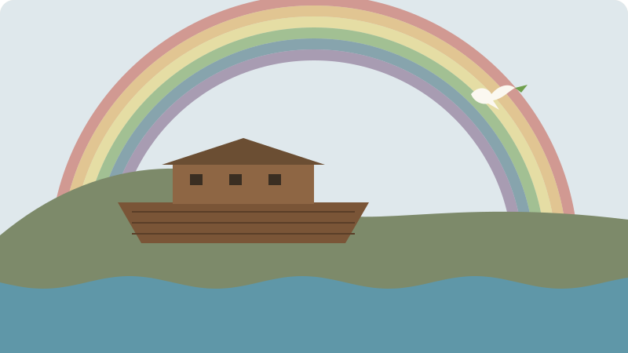

> Status: Draft (AI draft; not human reviewed) | 状态：Draft（AI 草稿，未人工审阅）
# Covenants of the Bible | 圣经中的约

> **In Three Sentences | 三句话读懂本篇**
>
> A [covenant](../Glossary/README.md#covenant) is a committed relationship with promises and responsibilities, and the Bible’s story moves forward through five main covenants. This page explains each one: with whom it is made, what is promised, its sign, and where to read. It then shows how the New Testament reads them together in Jesus. 
> [约](../Glossary/README.md#covenant)是带有应许和责任的郑重关系；圣经的故事借着五个主要的约向前推进。本篇逐一说明每个约是与谁立的、应许了什么、记号是什么、该读哪几章，再看新约怎样在耶稣里把它们连在一起。

> **Language status | 语言状态:** Fully bilingual, paragraph by paragraph.
>
> **语言状态 | Language status：** 全文按段落提供中英双语。

In the ancient world, a covenant bound two parties together with promises, obligations, and often a sign or ceremony. In the Bible, God himself takes the initiative to make covenants with people. Following these covenants is one of the clearest ways to see how the whole Bible holds together. 
在古代世界，约用应许、义务，常常还有记号或仪式，把双方连结在一起。在圣经中，是神自己主动与人立约。顺着这些约来读，是看清整本圣经怎样连成一体的最清楚的方法之一。

## Route Guide | 路线导航

| Section | 章节 |
| --- | --- |
| [The five covenants at a glance](#at-a-glance) | [五个约一览](#at-a-glance) |
| [The covenant with Noah](#noah-covenant) | [与挪亚立的约](#noah-covenant) |
| [The covenant with Abraham](#abraham-covenant) | [与亚伯拉罕立的约](#abraham-covenant) |
| [The covenant at Sinai](#sinai-covenant) | [西奈之约](#sinai-covenant) |
| [The covenant with David](#david-covenant) | [与大卫立的约](#david-covenant) |
| [The new covenant](#new-covenant) | [新约](#new-covenant) |
| [How the covenants fit together](#how-they-connect) | [这些约怎样连在一起](#how-they-connect) |
| [Questions for reflection](#questions) | [思考问题](#questions) |

## The Five Covenants at a Glance | 五个约一览

| Covenant / 约 | With / 对象 | Main promise / 主要应许 | Sign / 记号 | Read / 阅读 |
| --- | --- | --- | --- | --- |
| Noah / 挪亚 | All living creatures / 一切活物 | No flood will again destroy the earth / 不再用洪水毁灭大地 | Rainbow / 彩虹 | Genesis 9 / 创 9 |
| Abraham / 亚伯拉罕 | Abraham and his offspring / 亚伯拉罕及其后裔 | Offspring, land, blessing for all nations / 后裔、土地、万国得福 | Circumcision / 割礼 | Genesis 12, 15, 17 / 创 12、15、17 |
| Sinai / 西奈 | Israel / 以色列 | God’s treasured people; life under his law / 作神的子民，活在祂的律法之下 | Sabbath / 安息日 | Exodus 19–24 / 出 19–24 |
| David / 大卫 | David and his royal line / 大卫及其王室后裔 | A lasting house and throne / 家与王位永远坚立 | No single sign named / 未指明单一记号 | 2 Samuel 7 / 撒下 7 |
| New / 新约 | God’s people, Jews and Gentiles / 神的子民，包括犹太人与外邦人 | Law on the heart, sins forgiven, the Spirit given / 律法写在心上、罪得赦免、赐下圣灵 | Lord’s Supper cup / 主的晚餐之杯 | Jeremiah 31; Luke 22 / 耶 31；路 22 |

The table simplifies. Several covenants are confirmed more than once, and Christian traditions describe the relationships between them in different ways. 
这张表是简化的：有几个约不止一次被重申，不同的基督教传统对它们之间的关系也有不同的描述。

## The Covenant with Noah | 与挪亚立的约

*Original illustration for this library; not historical evidence. / 本资料库原创插画，不作为历史证据。* [About the illustrations | 插画说明](../CREDITS.md#original-illustrations)

**Read | 阅读：** Genesis 8:20–9:17 / 创世记 8:20–9:17

After the flood, God makes a covenant not only with Noah’s family but with every living creature. He promises never again to destroy the earth by a flood, and he sets his bow in the clouds as a sign. God makes this promise even though he knows the human heart is still inclined to evil (Genesis 8:21). It is his commitment to preserve the world so that his larger purpose can continue. 
洪水之后，神不仅与挪亚一家立约，也与一切活物立约。祂应许不再用洪水毁灭大地，并把虹放在云彩中作记号。神明知人心仍然从小就怀着恶念（创世记 8:21），仍然作出这个应许。这是神保存世界的承诺，使祂更大的计划得以延续。

## The Covenant with Abraham | 与亚伯拉罕立的约

*Original illustration for this library; not historical evidence. / 本资料库原创插画，不作为历史证据。* [About the illustrations | 插画说明](../CREDITS.md#original-illustrations)

**Read | 阅读：** Genesis 12:1–3, 15, and 17 / 创世记 12:1–3、15 章、17 章

God calls Abraham and promises him three things: offspring as many as the stars, the land of Canaan, and blessing that will reach all the families of the earth. In Genesis 15, God alone passes between the pieces of the sacrifice, showing that he binds himself to keep the promise. In Genesis 17, circumcision becomes the sign of the covenant for Abraham’s household. 
神呼召亚伯拉罕，应许他三件事：多如天上星的后裔、迦南地，以及要临到地上万族的祝福。在创世记 15 章，只有神从劈开的祭牲中间经过，表明祂亲自承担成就应许的责任。在 17 章，割礼成为亚伯拉罕全家立约的记号。

## The Covenant at Sinai | 西奈之约

*Original illustration for this library; not historical evidence. / 本资料库原创插画，不作为历史证据。* [About the illustrations | 插画说明](../CREDITS.md#original-illustrations)

**Read | 阅读：** Exodus 19–24; Deuteronomy 28–30 / 出埃及记 19–24 章；申命记 28–30 章

After rescuing Israel from Egypt, God brings the people to Mount Sinai and offers them a covenant: they will be his treasured possession and a kingdom of priests. He gives the Ten Commandments and the law to shape their life together, and the Sabbath is called a sign between God and Israel. The order matters: rescue comes first, and the law is given to a people already saved. Deuteronomy sets out blessing for faithfulness and curse for unfaithfulness, and the later history of Israel is read in that light. 
神把以色列人从埃及救出来之后，带他们到西奈山，与他们立约：他们要归神作子民，作祭司的国度。神颁布十诫和律法，塑造他们的群体生活，并称安息日为神与以色列之间的记号。次序很重要：先有拯救，律法是赐给已经蒙拯救的百姓。申命记说明忠心就蒙福、背约就受咒诅，以色列后来的历史也照这个角度来解读。

## The Covenant with David | 与大卫立的约

*Original illustration for this library; not historical evidence. / 本资料库原创插画，不作为历史证据。* [About the illustrations | 插画说明](../CREDITS.md#original-illustrations)

**Read | 阅读：** 2 Samuel 7; Psalm 89 / 撒母耳记下 7 章；诗篇 89 篇

David wants to build a house for God, but God promises instead to build a “house” for David: a royal line whose throne will last forever. David’s son will build the temple, and God will be a father to him. When later kings fail and the line seems to end in exile, the prophets and psalms keep hoping for a king from David’s family. 
大卫想为神建殿，神却应许要为大卫建立“家”：一个王位永远坚立的王室。大卫的儿子要建造圣殿，神要作他的父。后来的君王失败了，王室似乎在被掳中断绝，先知和诗篇却仍然盼望一位出自大卫家的王。

## The New Covenant | 新约

*Original illustration for this library; not historical evidence. / 本资料库原创插画，不作为历史证据。* [About the illustrations | 插画说明](../CREDITS.md#original-illustrations)

**Read | 阅读：** Jeremiah 31:31–34; Ezekiel 36:24–28; Luke 22:14–20; Hebrews 8 / 耶利米书 31:31–34；以西结书 36:24–28；路加福音 22:14–20；希伯来书 8 章

When Israel breaks the Sinai covenant and goes into exile, Jeremiah announces a new covenant. God will write his law on people’s hearts, everyone will know him, and he will forgive their sins. Ezekiel adds the promise of a new heart and God’s Spirit within. At his last meal, Jesus takes the cup and calls it “the new covenant in my blood,” and the New Testament presents this covenant as fulfilled through his death and resurrection. 
以色列背弃西奈之约而被掳时，耶利米宣告一个新约：神要把律法写在人心上，人人都要认识祂，祂也要赦免他们的罪。以西结又加上应许：赐人新心，并把神的灵放在他们里面。耶稣在最后的晚餐上拿起杯，称它为“用我血所立的新约”；新约圣经说明这个约借着祂的死与复活得以成就。

The word “new” does not mean the earlier covenants were mistakes. In the New Testament, the promises to Abraham and David are kept in Jesus, and the purpose of the Sinai law is now written on the heart. 
“新”并不表示以前的约是错误。在新约圣经中，给亚伯拉罕和大卫的应许在耶稣身上得以成就，西奈律法的目的如今被写在人心里。

## How the Covenants Fit Together | 这些约怎样连在一起

1. Noah: God preserves the world so that his plan can continue.
   挪亚：神保存世界，使祂的计划得以延续。
2. Abraham: God chooses one family to bring blessing to every nation.
   亚伯拉罕：神拣选一个家族，要借着它把祝福带给万国。
3. Sinai: God shapes that family into a people who live under his rule.
   西奈：神把这个家族塑造成活在祂治理之下的子民。
4. David: God promises a king from this people whose throne will last.
   大卫：神应许从这群子民中兴起一位王位永远坚立的君王。
5. New covenant: God promises to change hearts, forgive sins, and give his Spirit; the New Testament sees all the earlier promises meet in Jesus.
   新约：神应许改变人心、赦免罪、赐下圣灵；新约圣经认为先前所有的应许都在耶稣身上汇合。

Christians agree that these covenants belong to one story, but they describe the details differently. Some speak of a covenant with Adam at creation; others do not. Traditions also differ on how the Sinai law applies to Christians today. This page gives the shared outline; the [Bible Timeline](./Bible_Timeline_Bilingual.md) shows where each covenant falls in the story. 
基督徒都认同这些约属于同一个故事，但在细节上有不同描述：有人认为创造时神已与亚当立约，有人不这样看；各传统对西奈律法今天怎样适用于基督徒，也有不同理解。本篇只给出共同的大纲；每个约在故事中的位置，见[圣经时间线](./Bible_Timeline_Bilingual.md)。

## Questions for Reflection | 思考问题

1. In each covenant, who takes the first step? What does that suggest about God?
   在每个约里，是谁先采取行动？这说明神是怎样的一位？
2. Why do you think God gave the law at Sinai only after he had rescued Israel?
   你认为神为什么在拯救以色列之后，才在西奈颁布律法？
3. Which promise to Abraham do you see reaching furthest into the New Testament?
   给亚伯拉罕的哪一项应许，你认为在新约中延伸得最远？
4. What does it mean to you that the new covenant promises a changed heart, not only changed behavior?
   新约应许改变的是人心，而不只是行为——这对你有什么意义？

[Back to Project Covenant | 返回项目首页](../README.md) · [Back to the Bible Timeline Research Hub | 返回圣经时间线研究中心](./README.md)
