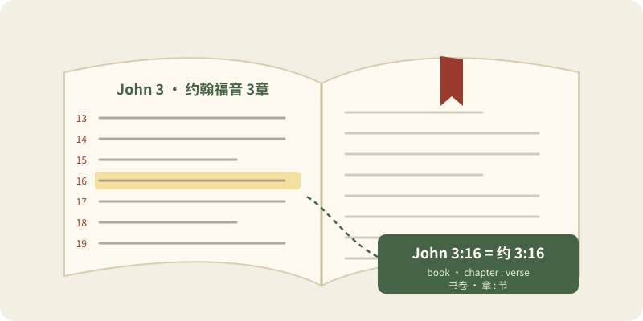

> Status: Draft (AI draft; not human reviewed) | 状态：Draft（AI 草稿，未人工审阅）
# Bible Reading Toolkit | 读经工具箱

> **In Three Sentences | 三句话读懂本篇**
>
> This page explains how to find a passage from a reference such as John 3:16. It lists all 66 books with common abbreviations and chapter counts. It also gives plain reading tips for each kind of writing in the Bible. 
> 本篇说明怎样根据“约翰福音 3:16”这类出处找到经文，列出 66 卷书的常用缩写和章数，并为圣经中不同文体提供简明的读法提示。

> **Language status | 语言状态:** Fully bilingual, paragraph by paragraph.
>
> **语言状态 | Language status：** 全文按段落提供中英双语。

Keep this page open beside your Bible. Use it as a lookup tool, not as a course to finish in one sitting. If you are completely new, read [First Steps in the Bible Story](./First_Steps_Bilingual.md) first, then come back when a reference or an unfamiliar kind of writing slows you down. 
读经时可以把本页放在旁边，当作查找工具，不必一次读完。如果你第一次接触圣经，先读[圣经故事线第一步](./First_Steps_Bilingual.md)；遇到看不懂的出处或陌生文体时，再回来查。

*Original illustration for this library; not historical evidence. / 本资料库原创插画，不作为历史证据。* [About the illustrations | 插画说明](../CREDITS.md#original-illustrations)

## Route Guide | 路线导航

| Route | 跳转 |
| --- | --- |
| [Reading a reference](#reference) | [看懂经文出处](#reference) |
| [Old Testament: 39 books](#old-testament-books) | [旧约 39 卷](#old-testament-books) |
| [New Testament: 27 books](#new-testament-books) | [新约 27 卷](#new-testament-books) |
| [Kinds of writing](#genres) | [文体与读法](#genres) |
| [Four questions for any passage](#four-questions) | [读任何经文的四个问题](#four-questions) |
| [Common questions](#faq) | [初读常见问题](#faq) |
| [What to read next](#next-steps) | [下一步读什么](#next-steps) |

## Reading a Reference | 看懂经文出处

A Bible reference names a book, then a chapter, then a verse. “John 3:16” means the book of John, chapter 3, verse 16. In Chinese it is written 约翰福音 3:16 or, in short form, 约 3:16, and read as “约翰福音三章十六节”. 
经文出处依次写出书卷、章和节。“约翰福音 3:16”指约翰福音第 3 章第 16 节；简写为“约 3:16”，读作“约翰福音三章十六节”。

| Written form / 写法 | Meaning | 含义 |
| --- | --- | --- |
| John 3 / 约 3 | The whole of chapter 3 | 第 3 章全章 |
| John 3:16 / 约 3:16 | Chapter 3, verse 16 | 第 3 章第 16 节 |
| John 3:16–18 / 约 3:16–18 | Verses 16 through 18 of chapter 3 | 第 3 章第 16 至 18 节 |
| John 3:16, 18 / 约 3:16, 18 | Verses 16 and 18 only | 只读第 16 节和第 18 节 |
| John 3–4 / 约 3–4 | Chapters 3 through 4 | 第 3 至 4 章 |
| John 3:16–4:3 / 约 3:16–4:3 | From 3:16 across the chapter break to 4:3 | 从 3:16 跨章读到 4:3 |
| 1 John 1:9 / 约一 1:9 | First John, a different book from the Gospel of John | 约翰一书，与约翰福音是不同的书 |
| Psalm 23 / 诗 23 | Psalm 23; each psalm is counted as one chapter | 诗篇第 23 篇；诗篇每一篇相当于一章 |

A number before a book name points to a separate book, not a chapter: 1 Samuel and 2 Samuel are two books. Chinese places the number after the name, as in 撒母耳记上 and 撒母耳记下, or 约翰一书, 约翰二书 and 约翰三书. 
书名前的数字表示另一卷书，而不是章数：1 Samuel 和 2 Samuel 是两卷书。中文把序号放在书名后面，例如“撒母耳记上／下”，或“约翰一书／二书／三书”。

Chapter and verse numbers were added long after the books were written. Chapter divisions now in common use are usually credited to Stephen Langton in the early thirteenth century; New Testament verse numbers come from a 1551 Greek–Latin edition printed by Robert Estienne. The numbers help readers find a place, but they sometimes cut through a sentence or a story, so read a few verses before and after. 
章节编号是在各卷成书很久以后才加上的。今天通用的分章一般归于十三世纪初的兰顿（Stephen Langton）；新约分节来自埃蒂安（Robert Estienne）1551 年印行的希腊文—拉丁文版本。编号方便查找，但有时会把一句话或一个故事从中间切开，所以要连同前后几节一起读。

Numbering can differ slightly between translations. Many English and Chinese Bibles divide Joel into three chapters and Malachi into four, while Hebrew Bibles use four and three. Some modern translations print a few verses, such as Acts 8:37, only in footnotes because ancient manuscripts differ. If a verse seems to be missing, check the footnotes before assuming an error. 
不同译本的编号偶有差异。许多英文和中文圣经把约珥书分为三章、玛拉基书分为四章，希伯来文圣经则分别分为四章和三章。由于古代[抄本](../Glossary/README.md#manuscript)有差异，一些现代译本只在脚注中列出少数经节，例如使徒行传 8:37。若觉得某一节“不见了”，先查看脚注，不要马上认定是错误。

## The 66 Books: Names, Abbreviations, Chapters | 66 卷书名、缩写与章数

The tables follow the 66-book Protestant [canon](../Glossary/README.md#canon) used across this library. Catholic and Orthodox Bibles include additional Old Testament books. English abbreviations follow one common style; you will see other short forms. Chinese abbreviations follow the form widely used with the Chinese Union Version (和合本). 
下表采用本资料库通用的 66 卷新教[正典](../Glossary/README.md#canon)书目；天主教和东正教圣经的旧约还包括其他书卷。英文缩写采用一种常见写法，你也会看到其他简写；中文缩写采用和合本读者普遍使用的形式。

For what each book is about and how it fits the story, use [Bible by Book](./Bible_By_Book_Bilingual.md). 
各卷的内容和它在故事线中的位置，请看[按书卷梳理圣经](./Bible_By_Book_Bilingual.md)。

*Original illustration for this library; not historical evidence. / 本资料库原创插画，不作为历史证据。* [About the illustrations | 插画说明](../CREDITS.md#original-illustrations)

### Old Testament: 39 Books, 929 Chapters | 旧约：39 卷，929 章

| # | Book | Abbr. | 书卷 | 缩写 | Chapters / 章数 |
| ---: | --- | --- | --- | --- | ---: |
| 1 | Genesis | Gen | 创世记 | 创 | 50 |
| 2 | Exodus | Exod | 出埃及记 | 出 | 40 |
| 3 | Leviticus | Lev | 利未记 | 利 | 27 |
| 4 | Numbers | Num | 民数记 | 民 | 36 |
| 5 | Deuteronomy | Deut | 申命记 | 申 | 34 |
| 6 | Joshua | Josh | 约书亚记 | 书 | 24 |
| 7 | Judges | Judg | 士师记 | 士 | 21 |
| 8 | Ruth | Ruth | 路得记 | 得 | 4 |
| 9 | 1 Samuel | 1 Sam | 撒母耳记上 | 撒上 | 31 |
| 10 | 2 Samuel | 2 Sam | 撒母耳记下 | 撒下 | 24 |
| 11 | 1 Kings | 1 Kgs | 列王纪上 | 王上 | 22 |
| 12 | 2 Kings | 2 Kgs | 列王纪下 | 王下 | 25 |
| 13 | 1 Chronicles | 1 Chr | 历代志上 | 代上 | 29 |
| 14 | 2 Chronicles | 2 Chr | 历代志下 | 代下 | 36 |
| 15 | Ezra | Ezra | 以斯拉记 | 拉 | 10 |
| 16 | Nehemiah | Neh | 尼希米记 | 尼 | 13 |
| 17 | Esther | Esth | 以斯帖记 | 斯 | 10 |
| 18 | Job | Job | 约伯记 | 伯 | 42 |
| 19 | Psalms | Ps | 诗篇 | 诗 | 150 |
| 20 | Proverbs | Prov | 箴言 | 箴 | 31 |
| 21 | Ecclesiastes | Eccl | 传道书 | 传 | 12 |
| 22 | Song of Songs | Song | 雅歌 | 歌 | 8 |
| 23 | Isaiah | Isa | 以赛亚书 | 赛 | 66 |
| 24 | Jeremiah | Jer | 耶利米书 | 耶 | 52 |
| 25 | Lamentations | Lam | 耶利米哀歌 | 哀 | 5 |
| 26 | Ezekiel | Ezek | 以西结书 | 结 | 48 |
| 27 | Daniel | Dan | 但以理书 | 但 | 12 |
| 28 | Hosea | Hos | 何西阿书 | 何 | 14 |
| 29 | Joel | Joel | 约珥书 | 珥 | 3 |
| 30 | Amos | Amos | 阿摩司书 | 摩 | 9 |
| 31 | Obadiah | Obad | 俄巴底亚书 | 俄 | 1 |
| 32 | Jonah | Jonah | 约拿书 | 拿 | 4 |
| 33 | Micah | Mic | 弥迦书 | 弥 | 7 |
| 34 | Nahum | Nah | 那鸿书 | 鸿 | 3 |
| 35 | Habakkuk | Hab | 哈巴谷书 | 哈 | 3 |
| 36 | Zephaniah | Zeph | 西番雅书 | 番 | 3 |
| 37 | Haggai | Hag | 哈该书 | 该 | 2 |
| 38 | Zechariah | Zech | 撒迦利亚书 | 亚 | 14 |
| 39 | Malachi | Mal | 玛拉基书 | 玛 | 4 |

### New Testament: 27 Books, 260 Chapters | 新约：27 卷，260 章

| # | Book | Abbr. | 书卷 | 缩写 | Chapters / 章数 |
| ---: | --- | --- | --- | --- | ---: |
| 40 | Matthew | Matt | 马太福音 | 太 | 28 |
| 41 | Mark | Mark | 马可福音 | 可 | 16 |
| 42 | Luke | Luke | 路加福音 | 路 | 24 |
| 43 | John | John | 约翰福音 | 约 | 21 |
| 44 | Acts | Acts | 使徒行传 | 徒 | 28 |
| 45 | Romans | Rom | 罗马书 | 罗 | 16 |
| 46 | 1 Corinthians | 1 Cor | 哥林多前书 | 林前 | 16 |
| 47 | 2 Corinthians | 2 Cor | 哥林多后书 | 林后 | 13 |
| 48 | Galatians | Gal | 加拉太书 | 加 | 6 |
| 49 | Ephesians | Eph | 以弗所书 | 弗 | 6 |
| 50 | Philippians | Phil | 腓立比书 | 腓 | 4 |
| 51 | Colossians | Col | 歌罗西书 | 西 | 4 |
| 52 | 1 Thessalonians | 1 Thess | 帖撒罗尼迦前书 | 帖前 | 5 |
| 53 | 2 Thessalonians | 2 Thess | 帖撒罗尼迦后书 | 帖后 | 3 |
| 54 | 1 Timothy | 1 Tim | 提摩太前书 | 提前 | 6 |
| 55 | 2 Timothy | 2 Tim | 提摩太后书 | 提后 | 4 |
| 56 | Titus | Titus | 提多书 | 多 | 3 |
| 57 | Philemon | Phlm | 腓利门书 | 门 | 1 |
| 58 | Hebrews | Heb | 希伯来书 | 来 | 13 |
| 59 | James | Jas | 雅各书 | 雅 | 5 |
| 60 | 1 Peter | 1 Pet | 彼得前书 | 彼前 | 5 |
| 61 | 2 Peter | 2 Pet | 彼得后书 | 彼后 | 3 |
| 62 | 1 John | 1 John | 约翰一书 | 约一 | 5 |
| 63 | 2 John | 2 John | 约翰二书 | 约二 | 1 |
| 64 | 3 John | 3 John | 约翰三书 | 约三 | 1 |
| 65 | Jude | Jude | 犹大书 | 犹 | 1 |
| 66 | Revelation | Rev | 启示录 | 启 | 22 |

The Old Testament totals 929 chapters and the New Testament 260, for 1,189 chapters in all. Psalms is the longest book by chapter count (150); Obadiah, Philemon, 2 John, 3 John and Jude have one chapter each, so references to them often give only a verse number, as in Jude 3. 
旧约共 929 章，新约共 260 章，合计 1,189 章。按章数计，诗篇最长（150 篇）；俄巴底亚书、腓利门书、约翰二书、约翰三书和犹大书都只有一章，所以出处常只写节数，例如“犹 3”。

## Kinds of Writing and How to Read Them | 文体与读法

The Bible is a library, not a single kind of book. A poem, a law code and a letter each ask for a different kind of attention. Knowing the kind of writing helps you ask fair questions of it. 
圣经像一座图书馆，而不是只有一种文体的书。诗歌、法典和书信各自需要不同的读法；先认出文体，才能向经文提出合适的问题。

### Narrative | 叙事

Where: Genesis, Exodus, Joshua to Esther, the Gospels and Acts. Follow the plot, the people and the turning points. A story often reports what someone did without approving it, so look for how the wider story evaluates the action. 
主要见于创世记、出埃及记、约书亚记至以斯帖记、福音书和使徒行传。留意情节、人物和转折点。叙事常常只记录某人做了什么，并不表示赞同，所以要看整个故事怎样评价这件事。

### Law | 律法

Where: Exodus 20 to Deuteronomy. These instructions shaped Israel’s worship and community life within a [covenant](../Glossary/README.md#covenant). Ask what each rule protected or taught, and how the New Testament reads it in light of Jesus, rather than lifting a single rule out of its setting. 
主要见于出埃及记 20 章至申命记。这些条例在[圣约](../Glossary/README.md#covenant)中塑造以色列的敬拜与群体生活。读时问：这条规定保护或教导什么？新约怎样在耶稣的光中理解它？不要把单条规定从原有处境中抽出来。

### Poetry and Song | 诗歌

Where: Psalms, Lamentations, Song of Songs and many passages in the prophets. Hebrew poetry often repeats an idea in a second line with new words, and it speaks in pictures. Read slowly, notice the images and feelings, and remember that honest complaint and lament are part of prayer. 
主要见于诗篇、耶利米哀歌、雅歌和先知书的许多段落。希伯来诗歌常在下一行换个说法重复同一意思，并大量使用图像。要慢慢读，留意画面与情感；坦诚的诉苦和哀歌也是祷告的一部分。

*Original illustration for this library; not historical evidence. / 本资料库原创插画，不作为历史证据。* [About the illustrations | 插画说明](../CREDITS.md#original-illustrations)

### Wisdom | 智慧文学

Where: Proverbs, Job and Ecclesiastes. Proverbs describe how life usually works; they are not promises that apply without exception. Job and Ecclesiastes test easy answers, so read each book as a whole conversation instead of quoting one speaker alone. 
主要见于箴言、约伯记和传道书。箴言描述人生通常的规律，不是毫无例外的应许。约伯记和传道书挑战简单答案，所以要把整卷当作一场完整对话来读，不要单独引用某一位发言者的话。

### Prophecy | 先知书

Where: Isaiah to Malachi. Most prophetic words first addressed Israel and Judah in their own time, calling them back to God and warning of consequences. Some also speak of God’s future rescue. Find the historical setting first, then ask how the promise is taken up later in the story. 
主要见于以赛亚书至玛拉基书。多数先知信息首先是对当时的以色列和犹大说的，呼召他们回转归向神，也警告后果；有些也讲到神将来的拯救。先找出历史处境，再问这个应许怎样在后来的故事中被接续。

### The Four Gospels | 四福音书

Where: Matthew, Mark, Luke and John. Each gives a portrait of Jesus for its first readers, so the same event may be told with different details or order. Read one Gospel at a time before comparing them; Mark is the shortest place to begin. 
即马太、马可、路加和约翰四卷。每卷都为最初的读者描绘耶稣，同一件事可能在细节或次序上有所不同。先完整读一卷，再作比较；马可福音篇幅最短，适合作为起点。

### Letters | 书信

Where: Romans to Jude. These were real letters to churches and people with specific questions. Read a whole letter in one sitting if you can, and follow the argument; a verse often depends on the paragraph before it. 
即罗马书至犹大书。它们是写给具体教会和个人、回应具体问题的真实书信。可能的话一次读完整封信，跟随作者的论证；一节经文常常依赖前一段的意思。

*Original illustration for this library; not historical evidence. / 本资料库原创插画，不作为历史证据。* [About the illustrations | 插画说明](../CREDITS.md#original-illustrations)

### Apocalyptic Visions | 启示文学

Where: parts of Daniel and the book of Revelation. These books use symbols, numbers and dramatic visions to show that God reigns over history. Look for the main message of hope and faithfulness before trying to decode each symbol, and be careful with confident date predictions. 
主要见于但以理书的部分章节和启示录。这类经文用象征、数字和戏剧性的异象，表明神掌管历史。先抓住盼望与忠心的主要信息，再试着理解各个象征；对言之凿凿的日期预测要格外谨慎。

## Four Questions for Any Passage | 读任何经文的四个问题

These questions are one simple pattern, not the only right method. They work alone, with a friend, or in a small group. 
下面四个问题只是一种简单做法，不是唯一正确的方法。可以独自使用，也可以和朋友或小组一起用。

1. **Observe | 观察:** What does the passage actually say? Who is speaking, to whom, where and when? What words repeat? 
   经文实际说了什么？谁在说话、对谁说、在哪里、什么时候？哪些词反复出现？
2. **Understand | 理解:** What would it have meant to its first hearers? Read the verses before and after, and check the kind of writing. 
   它对最初的听众意味着什么？读前后文，并确认它属于哪种文体。
3. **Connect | 连接:** Where does it sit in the [ten-stop storyline](./First_Steps_Bilingual.md#ten-stops)? What does it show about God, people and the promise that runs through the whole Bible? 
   它位于[十站故事线](./First_Steps_Bilingual.md#ten-stops)的哪一站？它让人看见神、人以及贯穿全本圣经的应许的哪一面？
4. **Respond | 回应:** What could you thank God for, ask him about, or put into practice this week? Write down a question you want to bring to someone you trust. 
   这周可以为什么感谢神、向神求问什么、实践什么？写下一个想请教可信任之人的问题。

## Common Questions for New Readers | 初读常见问题

### Do I need to start at Genesis 1? | 必须从创世记第一章开始读吗？

No. Reading straight through can stall in long lists of laws or names. Many readers begin with a Gospel, then return to Genesis. The [30-minute first reading](./First_Steps_Bilingual.md#thirty-minute-route) gives a short route across the whole story. 
不必。从头一直读下去，常会在大段律法条例或人名家谱中停下来。许多读者先读一卷福音书，再回到创世记。[30 分钟第一次阅读](./First_Steps_Bilingual.md#thirty-minute-route)提供一条贯穿整个故事的短路线。

### Why do some English Bibles print “LORD” in capitals? | 为什么有些英文圣经把 “LORD” 印成大写？

In many English translations, LORD in small capital letters stands for God’s personal name in Hebrew, written with four letters (YHWH). Ordinary “Lord” translates a different word meaning master. The Chinese Union Version usually renders the personal name as 耶和华 and uses 主 for “Lord”. 
在许多英文译本中，用小型大写字母印的 LORD 代表希伯来文中神的名字，由四个字母（YHWH）组成；普通写法的 “Lord” 则翻译另一个意为“主人”的词。和合本一般把这个名字译作“耶和华”，并用“主”翻译 “Lord”。

### Why do Chinese Bibles say 神 or 上帝? | 为什么中文圣经有的写“神”，有的写“上帝”？

The Chinese Union Version has long been printed in two editions that differ mainly in this one word: a 神 edition and a 上帝 edition. Both name the same God. This library usually writes 神, following the edition many Chinese churches read. 
和合本长期以两种版本印行，主要差别就在这一个词：“神版”和“上帝版”。两者指的是同一位神。本资料库一般写作“神”，与许多华人教会所用的版本一致。

### What do BC/AD and BCE/CE mean? | BC/AD 和 BCE/CE 是什么意思？

They count the same years. BC (“before Christ”) and BCE (“before the Common Era”) mean 公元前; AD (Latin *anno Domini*, “in the year of the Lord”) and CE mean 公元. There is no year zero, so 1 BC is followed directly by AD 1. 
两组写法计算的是同样的年份。BC 和 BCE 都表示“公元前”；AD（拉丁文 *anno Domini*，意为“主的年份”）和 CE 都表示“公元”。纪年中没有“公元 0 年”，公元前 1 年之后就是公元 1 年。

### Which translation should I use? | 应该用哪个译本？

Choose one readable translation for regular reading, and compare a second one when a word seems important or unclear. Respect each translation’s copyright when sharing text. See [Bible Translations](../Bible_Translations/README.md) for the translations this library uses and how to obtain them legally. 
平时选一个读得懂的译本固定阅读；遇到重要或难懂的词，再对照另一个译本。分享经文时尊重各译本的版权。本资料库使用的译本及合法获取方式，见[圣经译本](../Bible_Translations/README.md)。

## What to Read Next | 下一步读什么

- **Start the story | 从故事开始：** Read [First Steps in the Bible Story](./First_Steps_Bilingual.md) for ten short stops across the whole Bible.
  **从故事开始：** 阅读[圣经故事线第一步](./First_Steps_Bilingual.md)，用十个短站走过整本圣经。
- **Look up a book | 查一卷书：** Use [Bible by Book](./Bible_By_Book_Bilingual.md) to see what a book is about and how it connects to its neighbors.
  **查一卷书：** 用[按书卷梳理圣经](./Bible_By_Book_Bilingual.md)了解某卷书的内容及它与前后书卷的关系。
- **Look up a person | 查一个人物：** Use [People of the Bible](./Bible_People_Bilingual.md) to see who someone is and where to read about them.
  **查一个人物：** 用[圣经人物](./Bible_People_Bilingual.md)了解某人是谁、该读哪几章。
- **Look up a word | 查一个词：** Use the [Glossary](../Glossary/README.md) for short, plain-language explanations.
  **查一个词：** 在[词汇表](../Glossary/README.md)中查找简短的白话解释。

[Back to Project Covenant | 返回项目首页](../README.md) · [Back to the Bible Timeline Research Hub | 返回圣经时间线研究中心](./README.md)
