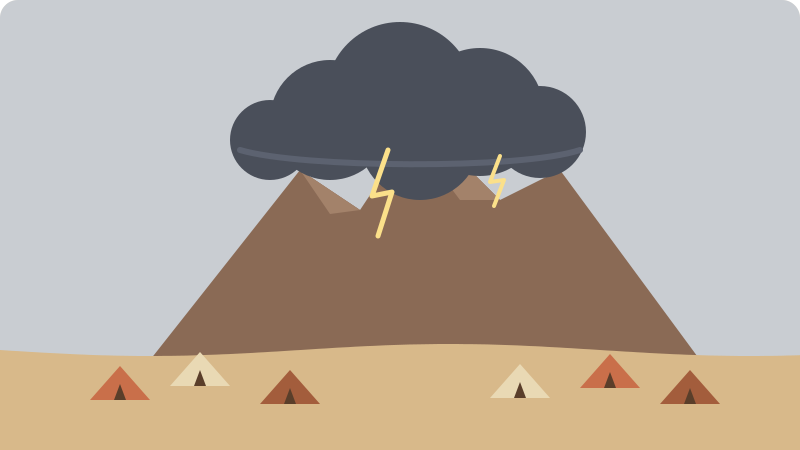

> Status: Draft (AI draft; not human reviewed) | 状态：Draft（AI 草稿，未人工审阅）
# The Ten Commandments | 十诫

> **In Three Sentences | 三句话读懂本篇**
>
> At Mount Sinai, God gave Israel ten short commands, written on two stone tablets, as the heart of his [covenant](../Glossary/README.md#covenant) with them. This page explains each commandment in plain words, shows why churches number them a little differently, and points to where they appear in the Bible. It also shows how Jesus summed them up as love for God and love for neighbor. 
> 在西奈山，神赐给以色列十条简短的诫命，写在两块石版上，作为祂与他们所立之[约](../Glossary/README.md#covenant)的核心。本篇用浅白的话解释每一条诫命，说明各教会的编号为什么略有不同，并指出它们在圣经中的出处。本篇也说明耶稣怎样把十诫总结为爱神和爱人。

> **Language status | 语言状态:** Fully bilingual, paragraph by paragraph.
>
> **语言状态 | Language status：** 全文按段落提供中英双语。

*Original illustration for this library; not historical evidence. / 本资料库原创插画，不作为历史证据。* [About the illustrations | 插画说明](../CREDITS.md#original-illustrations)

## Route Guide | 路线导航

| Section | 章节 |
| --- | --- |
| [Rescue comes first](#rescue-first) | [先有拯救](#rescue-first) |
| [The ten commandments](#the-ten) | [十条诫命](#the-ten) |
| [Why the numbering differs](#numbering) | [编号为什么不同](#numbering) |
| [How Jesus summed them up](#jesus-summary) | [耶稣怎样总结](#jesus-summary) |
| [What to read next](#next-steps) | [下一步读什么](#next-steps) |

## Rescue Comes First | 先有拯救

The Ten Commandments appear twice in the Bible: in Exodus 20:1–17 and in Deuteronomy 5:6–21. Before any command, God says who he is and what he has done: “I am the LORD your God, who brought you out of Egypt, out of the land of slavery” (Exodus 20:2). The commandments are not a way for slaves to earn freedom; they show freed people how to live with the God who rescued them and with one another. 
十诫在圣经中出现两次：出埃及记 20:1–17 和申命记 5:6–21。在颁布任何诫命之前，神先说明祂是谁、祂做了什么：“我是耶和华你的神，曾将你从埃及地为奴之家领出来”（出埃及记 20:2）。这些诫命不是奴隶用来换取自由的条件，而是告诉已经得自由的人，怎样与拯救他们的神、也与彼此一同生活。

Many readers see two parts. The first commandments are about how people relate to God; the rest are about how people treat one another. 
许多读者把十诫看作两部分：前几条讲人怎样对待神，其余几条讲人怎样对待彼此。

## The Ten Commandments | 十条诫命

The numbering below is the one most Chinese Protestant churches use. Other traditions group the same words differently; see [Why the numbering differs](#numbering). 
下面的编号是大多数华人新教教会所用的方式。其他传统会把同样的经文分得不太一样，见[编号为什么不同](#numbering)。

1. **No other gods | 除我以外，不可有别的神** — Exodus 20:3. Put nothing and no one in God’s place.
   出埃及记 20:3。不要让任何人或任何事物取代神的位置。
2. **No idols | 不可为自己雕刻偶像** — Exodus 20:4–6. Do not make images to worship; God is not to be shaped by human hands or controlled.
   出埃及记 20:4–6。不可制造偶像来敬拜；神不能被人手塑造，也不能被人操控。
3. **Do not misuse God’s name | 不可妄称耶和华你神的名** — Exodus 20:7. Do not use God’s name lightly, falsely, or to cover a lie.
   出埃及记 20:7。不可轻率地、虚假地使用神的名，也不可借神的名掩饰谎言。
4. **Keep the Sabbath holy | 当记念安息日，守为圣日** — Exodus 20:8–11. Rest one day in seven, and let workers, servants, and even animals rest too. Exodus links this to God resting after creation; Deuteronomy 5:15 links it to rescue from slavery. See [Sabbath](../Glossary/README.md#sabbath).
   出埃及记 20:8–11。七天中要有一天安息，也让工人、仆婢甚至牲畜一同安息。出埃及记把它与神创造之后的安息相连，申命记 5:15 则把它与脱离为奴之地相连。见[安息日](../Glossary/README.md#sabbath)。
5. **Honor your father and mother | 当孝敬父母** — Exodus 20:12. Respect and care for your parents; Paul calls this “the first commandment with a promise” (Ephesians 6:2).
   出埃及记 20:12。尊重并照顾父母；保罗称这是“第一条带应许的诫命”（以弗所书 6:2）。
6. **Do not murder | 不可杀人** — Exodus 20:13. Protect human life, because people are made in God’s image.
   出埃及记 20:13。要保护人的生命，因为人是照着神的形像造的。
7. **Do not commit adultery | 不可奸淫** — Exodus 20:14. Keep faith in marriage.
   出埃及记 20:14。在婚姻中要忠诚。
8. **Do not steal | 不可偷盗** — Exodus 20:15. Respect what belongs to others.
   出埃及记 20:15。尊重别人的财物。
9. **Do not give false testimony | 不可作假见证陷害人** — Exodus 20:16. Do not lie about your neighbor, especially in court.
   出埃及记 20:16。不可说谎陷害邻舍，在法庭上尤其如此。
10. **Do not covet | 不可贪恋** — Exodus 20:17. Do not set your heart on your neighbor’s house, spouse, workers, animals, or anything that is theirs. This last command reaches past actions to desires.
    出埃及记 20:17。不可贪图邻舍的房屋、配偶、仆婢、牲畜，或他一切所有的。最后这一条诫命不只针对行为，也触及内心的欲望。

## Why the Numbering Differs | 编号为什么不同

The Bible says there are “ten words” (Exodus 34:28; Deuteronomy 4:13), but it does not number them. Traditions divide the same verses in different ways: 
圣经说这是“十条诫”（出埃及记 34:28；申命记 4:13），却没有给它们编号。不同的传统把同样的经文分成不同的十条：

- **Jewish tradition** counts God’s opening words, “I am the LORD your God…,” as the first word, and joins “no other gods” and “no idols” as the second.
  **犹太传统**把神开头的话“我是耶和华你的神……”算作第一条，把“不可有别的神”和“不可雕刻偶像”合为第二条。
- **Catholic and Lutheran tradition** joins “no other gods” and “no idols” as the first commandment, and splits coveting into two: not coveting your neighbor’s spouse, and not coveting your neighbor’s goods.
  **天主教和路德宗传统**把“不可有别的神”和“不可雕刻偶像”合为第一条，并把“不可贪恋”分成两条：不可贪恋邻人的配偶，不可贪恋邻人的财物。
- **Orthodox, Reformed, Anglican, and most other Protestant churches** use the numbering on this page.
  **东正教、改革宗、圣公宗以及大多数其他新教教会**使用本页的编号方式。

The words are the same in every case; only the way they are counted differs. When a book says “the second commandment,” check which numbering it uses. 
不论哪种方式，经文本身都相同，只是计算的方法不同。书上提到“第二条诫命”时，先看看它用的是哪一种编号。

## How Jesus Summed Them Up | 耶稣怎样总结

When asked which commandment is greatest, Jesus quoted two other passages of the Law: love the Lord your God with all your heart, soul, and mind (Deuteronomy 6:5), and love your neighbor as yourself (Leviticus 19:18). He said that all the Law and the Prophets hang on these two (Matthew 22:37–40). 
有人问耶稣哪一条诫命最大，耶稣引用了律法书中另外两处经文：要尽心、尽性、尽意爱主你的神（申命记 6:5），以及要爱人如己（利未记 19:18）。祂说，全部律法和先知的道理，都是以这两条为总纲（马太福音 22:37–40）。

In the Sermon on the Mount, Jesus also showed that the commandments reach the heart: anger and contempt break the spirit of “do not murder,” and lustful looking breaks the spirit of “do not commit adultery” (Matthew 5:21–30). Paul later wrote that love does no harm to a neighbor, so love is the fulfillment of the [law](../Glossary/README.md#law) (Romans 13:8–10). 
在登山宝训中，耶稣也说明诫命触及人心：怒气和轻蔑违背了“不可杀人”的精意，动淫念的眼光违背了“不可奸淫”的精意（马太福音 5:21–30）。保罗后来写道，爱是不加害于人的，所以爱就完全了[律法](../Glossary/README.md#law)（罗马书 13:8–10）。

## What to Read Next | 下一步读什么

- **Read the whole scene | 读整段经文：** Exodus 19–20 tells how the people met God at Sinai before the commandments were given.
  **读整段经文：** 出埃及记 19–20 章记载百姓在领受诫命之前，怎样在西奈山与神相遇。
- **See the covenant | 看看这个约：** [Covenants of the Bible](./Bible_Covenants_Bilingual.md) explains the Sinai covenant and how it fits the larger story.
  **看看这个约：** [圣经中的约](./Bible_Covenants_Bilingual.md)说明西奈之约，以及它在整个故事中的位置。
- **Learn the key passages | 熟悉重点经文：** [Key Passages to Know](./Key_Passages_Bilingual.md) includes the Ten Commandments and the Sermon on the Mount.
  **熟悉重点经文：** [值得熟悉的经文](./Key_Passages_Bilingual.md)收录了十诫和登山宝训。

[Back to Project Covenant | 返回项目首页](../README.md) · [Back to the Bible Timeline Research Hub | 返回圣经时间线研究中心](./README.md)
