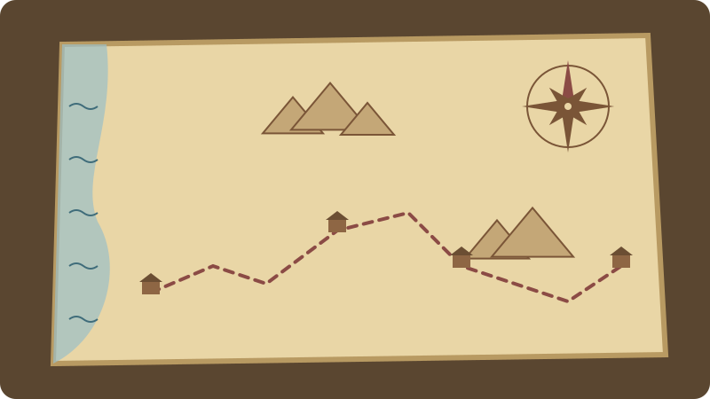

> Status: Draft (AI draft; not human reviewed) | 状态：Draft（AI 草稿，未人工审阅）
# Places of the Bible | 圣经地名

> **In Three Sentences | 三句话读懂本篇**
>
> This page introduces twenty-five places where key parts of the Bible’s story happen, in story order. Each entry tells you what happens there, where to read, and which map in this library shows it. Some locations are disputed, and the entries say so instead of guessing. 
> 本篇按故事顺序介绍圣经故事中二十五个重要地点。每一条都说明那里发生了什么、该读哪几章，以及本资料库哪一幅地图标出了它。有些地点的位置仍有争议，条目会直接说明，而不是猜测。

> **Language status | 语言状态:** Fully bilingual, paragraph by paragraph.
>
> **语言状态 | Language status：** 全文按段落提供中英双语。

The Bible’s story moves across real landscapes: river valleys, deserts, hill country, and the cities of great empires. Knowing where a place is, and what already happened there, often explains why a later passage mentions it. 
圣经的故事发生在真实的地理之中：河谷、旷野、山地，以及大帝国的城市。知道一个地方在哪里、以前在那里发生过什么，常常能帮助我们明白后面的经文为什么提到它。

*Original illustration for this library; not historical evidence. / 本资料库原创插画，不作为历史证据。* [About the illustrations | 插画说明](../CREDITS.md#original-illustrations)

## Route Guide | 路线导航

| Stage | 阶段 |
| --- | --- |
| [Journeys of the patriarchs and the exodus](#patriarchs-and-exodus) | [列祖的旅程与出埃及](#patriarchs-and-exodus) |
| [The land and the kingdom](#land-and-kingdom) | [应许之地与王国](#land-and-kingdom) |
| [Empires and exile](#empires-and-exile) | [帝国与被掳](#empires-and-exile) |
| [The land of Jesus](#land-of-jesus) | [耶稣的家乡与事工之地](#land-of-jesus) |
| [The good news reaches the nations](#gospel-to-nations) | [福音传到万民](#gospel-to-nations) |
| [What to read next](#next-steps) | [下一步读什么](#next-steps) |

## Journeys of the Patriarchs and the Exodus | 列祖的旅程与出埃及

### Ur | 吾珥

**Read | 阅读：** Genesis 11:27–32 / 创世记 11:27–32

Abram’s family sets out from “Ur of the Chaldeans” in Mesopotamia. Many scholars identify it with the southern city of Ur near the Euphrates, but northern sites have also been proposed. 
亚伯兰一家从美索不达米亚的“迦勒底的吾珥”出发。许多学者认为它就是幼发拉底河附近的南部古城吾珥，但也有人提出北方的其他地点。

**Map | 地图：** [Abraham’s Journey | 亚伯拉罕的旅程](./README.md#map-abraham-journey)

### Haran | 哈兰

**Read | 阅读：** Genesis 11:31–12:5 and 29 / 创世记 11:31–12:5、29 章

The family settles in Haran, and from there God calls Abram to go to the land he will show him. Later Jacob works in this region for his uncle Laban and marries Leah and Rachel. 
这家人在哈兰住下，神从那里呼召亚伯兰往祂要指示的地去。后来雅各在这一带为舅舅拉班工作，娶了利亚和拉结。

**Map | 地图：** [Abraham’s Journey | 亚伯拉罕的旅程](./README.md#map-abraham-journey)

### Bethel | 伯特利

**Read | 阅读：** Genesis 28:10–22; 1 Kings 12:25–33 / 创世记 28:10–22；列王纪上 12:25–33

Its name means “house of God.” Here Jacob dreams of a stairway reaching heaven and hears God’s promise. Centuries later, the northern kingdom sets up a golden calf at Bethel, and the prophets condemn it. 
伯特利的意思是“神的殿”。雅各在这里梦见一道通天的梯子，并听见神的应许。几百年后，北国在伯特利设立金牛犊，先知们予以谴责。

**Map | 地图：** [Abraham’s Journey | 亚伯拉罕的旅程](./README.md#map-abraham-journey)

### Egypt | 埃及

**Read | 阅读：** Genesis 41–47; Exodus 1–14; Matthew 2:13–15 / 创世记 41–47 章；出埃及记 1–14 章；马太福音 2:13–15

Joseph rises to power in Egypt, and Jacob’s family settles in the region of Goshen. Their descendants are later enslaved, and God brings them out. In Matthew, the child Jesus also finds refuge in Egypt. 
约瑟在埃及掌权，雅各一家住在歌珊地。他们的后代后来沦为奴隶，神领他们出来。在马太福音中，幼年的耶稣也曾在埃及避难。

**Map | 地图：** [Exodus: Two Route Models | 出埃及：两种路线模型](./README.md#map-exodus-models)

### Mount Sinai | 西奈山

**Read | 阅读：** Exodus 19–20; 1 Kings 19:8–18 / 出埃及记 19–20 章；列王纪上 19:8–18

At this mountain, also called Horeb, God makes a covenant with Israel and gives the Ten Commandments. Elijah later flees here and meets God in a quiet voice. Where the mountain lies is still debated. 
在这座又称何烈山的山上，神与以色列立约，颁布十诫。后来以利亚逃到这里，在微小的声音中与神相遇。这座山的具体位置至今仍有争议。

**Map | 地图：** [Exodus: Two Route Models | 出埃及：两种路线模型](./README.md#map-exodus-models)

## The Land and the Kingdom | 应许之地与王国

### Jordan River | 约旦河

**Read | 阅读：** Joshua 3–4; Mark 1:9–11 / 约书亚记 3–4 章；马可福音 1:9–11

Israel crosses the Jordan to enter the promised land, and the people set up stones to remember it. Centuries later, John baptizes Jesus in the same river. 
以色列人渡过约旦河进入应许之地，并立石头作记念。许多世纪以后，约翰在同一条河里为耶稣施洗。

**Map | 地图：** [Palestine in the Time of Jesus | 耶稣时代的巴勒斯坦](./README.md#gospel-geography)

### Jericho | 耶利哥

**Read | 阅读：** Joshua 6; Luke 19:1–10 / 约书亚记 6 章；路加福音 19:1–10

The first city Israel faces in the land, Jericho falls after the people march around its walls. In the Gospels, Jesus passes through Jericho and stays at the house of Zacchaeus. How the excavations relate to Joshua 6 is debated; see [Joshua to Kingdom Formation](../Bible_Timeline/约书亚至王国形成_考古模型与证据边界.md). 
耶利哥是以色列进入应许之地后面对的第一座城，百姓绕城行走之后城墙倒塌。在福音书中，耶稣经过耶利哥，住在撒该家里。考古发掘与约书亚记 6 章的关系仍有争论，见[《约书亚至王国形成》](../Bible_Timeline/约书亚至王国形成_考古模型与证据边界.md)。

**Map | 地图：** [Palestine in the Time of Jesus | 耶稣时代的巴勒斯坦](./README.md#gospel-geography)

### Shiloh | 示罗

**Read | 阅读：** Joshua 18:1; 1 Samuel 1–3 / 约书亚记 18:1；撒母耳记上 1–3 章

The tabernacle stands at Shiloh for a long period after Israel enters the land. Here Hannah prays for a son, and the boy Samuel hears God call his name in the night. 
以色列人进入应许之地后，会幕长期设在示罗。哈拿在这里祷告求子，少年撒母耳在夜里听见神呼唤他的名字。

### Bethlehem | 伯利恒

**Read | 阅读：** Ruth 1–4; 1 Samuel 16; Micah 5:2; Luke 2:1–20 / 路得记 1–4 章；撒母耳记上 16 章；弥迦书 5:2；路加福音 2:1–20

A small town south of Jerusalem, Bethlehem is where Ruth and Boaz marry and where David grows up. The prophet Micah says a ruler will come from there, and the Gospels tell of Jesus’ birth there. 
伯利恒是耶路撒冷以南的一座小城，路得和波阿斯在这里成婚，大卫在这里长大。先知弥迦说有一位掌权者要从这里出来；福音书记载耶稣在这里出生。

**Map | 地图：** [Palestine in the Time of Jesus | 耶稣时代的巴勒斯坦](./README.md#gospel-geography)

### Jerusalem | 耶路撒冷

**Read | 阅读：** 2 Samuel 5–6; 1 Kings 8; 2 Kings 25; Luke 23–24; Acts 2 / 撒母耳记下 5–6 章；列王纪上 8 章；列王纪下 25 章；路加福音 23–24 章；使徒行传 2 章

David makes Jerusalem his capital, and Solomon builds the temple there. Babylon destroys the city and temple, and the returning exiles rebuild them. Jesus is crucified and rises outside its walls, and the church begins there at Pentecost. 
大卫定都耶路撒冷，所罗门在这里建造圣殿。巴比伦摧毁了城和圣殿，归回的百姓又重建。耶稣在城外被钉十字架并复活，教会也在五旬节于此诞生。

**Map | 地图：** [Jerusalem in the Time of Jesus | 耶稣时代的耶路撒冷](./README.md#map-jerusalem-jesus)

### Samaria | 撒玛利亚

**Read | 阅读：** 1 Kings 16:23–24; 2 Kings 17; John 4:1–42 / 列王纪上 16:23–24；列王纪下 17 章；约翰福音 4:1–42

King Omri builds Samaria as the capital of the northern kingdom, and Assyria captures it in 722 BC. In Jesus’ day the name refers to the whole region, where he speaks with a Samaritan woman at a well. 
暗利王把撒玛利亚建为北国的首都，主前 722 年它被亚述攻陷。到了耶稣的时代，这个名字指整个地区；耶稣在那里的井旁与一位撒玛利亚妇人交谈。

**Map | 地图：** [The Divided Kingdoms | 王国分裂：北国与南国](./README.md#map-divided-kingdoms)

### Mount Carmel | 迦密山

**Read | 阅读：** 1 Kings 18:16–46 / 列王纪上 18:16–46

On this ridge near the Mediterranean, Elijah challenges the prophets of Baal. Fire falls on his altar, and the people cry out, “The LORD—he is God!” 
在这条靠近地中海的山岭上，以利亚向巴力的先知挑战。火从天降在他的坛上，百姓呼喊说：“耶和华是神！”

## Empires and Exile | 帝国与被掳

### Nineveh | 尼尼微

**Read | 阅读：** Jonah 1 and 3–4; Nahum 1–3 / 约拿书 1 章、3–4 章；那鸿书 1–3 章

A great city of the Assyrian Empire on the Tigris River, Nineveh is where God sends the reluctant prophet Jonah, and its people repent. Later, the prophet Nahum announces its fall. 
尼尼微是亚述帝国位于底格里斯河畔的大城。神差遣不情愿的先知约拿去那里，城里的人悔改了。后来先知那鸿宣告它的倾覆。

**Map | 地图：** [Empires in the Exile Story | 被掳时期的帝国](./README.md#map-exile-empires)

### Babylon | 巴比伦

**Read | 阅读：** 2 Kings 24–25; Psalm 137; Daniel 1–6; Revelation 18 / 列王纪下 24–25 章；诗篇 137 篇；但以理书 1–6 章；启示录 18 章

The capital of the Babylonian Empire, which destroys Jerusalem in 586 BC and carries Judah into exile. Daniel serves at its court. In Revelation, “Babylon” becomes a symbol for proud and violent world power. 
巴比伦是巴比伦帝国的首都，主前 586 年毁灭耶路撒冷，并把犹大人掳去。但以理在它的宫廷中供职。在启示录里，“巴比伦”成了骄傲、残暴的世上权势的象征。

**Map | 地图：** [Empires in the Exile Story | 被掳时期的帝国](./README.md#map-exile-empires)

### Susa | 书珊

**Read | 阅读：** Esther 1–2; Nehemiah 1–2 / 以斯帖记 1–2 章；尼希米记 1–2 章

A royal city of the Persian kings. Esther becomes queen in the palace at Susa, and Nehemiah serves there as the king’s cupbearer before returning to rebuild Jerusalem’s walls. 
书珊是波斯王的京城之一。以斯帖在书珊宫中成为王后；尼希米在这里作王的酒政，后来回去重建耶路撒冷的城墙。

**Map | 地图：** [Empires in the Exile Story | 被掳时期的帝国](./README.md#map-exile-empires)

## The Land of Jesus | 耶稣的家乡与事工之地

### Nazareth | 拿撒勒

**Read | 阅读：** Luke 1:26–38, 2:39–52, and 4:16–30 / 路加福音 1:26–38、2:39–52、4:16–30

A small village in Galilee where Mary receives the angel’s message and Jesus grows up. When Jesus later reads from Isaiah in its synagogue, the hometown crowd turns against him. 
拿撒勒是加利利的一个小村庄，马利亚在这里领受天使的信息，耶稣在这里长大。后来耶稣在这里的会堂读以赛亚书，家乡的人却起来反对祂。

**Map | 地图：** [Jesus’ Ministry in Galilee | 耶稣在加利利的事工](./README.md#map-galilee-ministry)

### Sea of Galilee | 加利利海

**Read | 阅读：** Mark 1:16–20 and 4:35–41; John 21 / 马可福音 1:16–20、4:35–41；约翰福音 21 章

A freshwater lake surrounded by fishing towns. Jesus calls fishermen to follow him on its shore, calms a storm on its waters, and after his resurrection meets his disciples there again. 
加利利海是一个淡水湖，四周是渔村。耶稣在湖边呼召渔夫跟从祂，在湖上平静风浪，复活后又在这里与门徒相见。

**Map | 地图：** [Jesus’ Ministry in Galilee | 耶稣在加利利的事工](./README.md#map-galilee-ministry)

### Capernaum | 迦百农

**Read | 阅读：** Matthew 4:13; Mark 1:21–34 and 2:1–12 / 马太福音 4:13；马可福音 1:21–34、2:1–12

A lakeside town that becomes Jesus’ base in Galilee. He teaches in its synagogue, heals many people there, and forgives and heals a paralyzed man lowered through a roof. 
迦百农是湖边的一座城，成了耶稣在加利利的据点。祂在那里的会堂教导、医治许多人，也赦免并医治了一个从房顶缒下来的瘫子。

**Map | 地图：** [Jesus’ Ministry in Galilee | 耶稣在加利利的事工](./README.md#map-galilee-ministry)

## The Good News Reaches the Nations | 福音传到万民

### Damascus | 大马士革

**Read | 阅读：** Acts 9:1–25 / 使徒行传 9:1–25

On the road to this Syrian city, Saul, who was persecuting the church, meets the risen Jesus. In Damascus he regains his sight, is baptized, and begins to preach. The Chinese Union Version spells the city 大马色. 
逼迫教会的扫罗在前往这座叙利亚城市的路上遇见复活的耶稣。他在大马士革重见光明、受洗，并开始传道。和合本把这座城写作“大马色”。

**Map | 地图：** [From Jerusalem to the Ends of the Earth | 从耶路撒冷到地极](./README.md#map-gospel-expansion)

### Antioch in Syria | 叙利亚的安提阿

**Read | 阅读：** Acts 11:19–26 and 13:1–3 / 使徒行传 11:19–26、13:1–3

A large city where Jews and Gentiles form one church. Here the disciples are first called Christians, and from here the church sends Barnabas and Paul on their first journey. 
安提阿是一座大城，犹太人和外邦人在这里组成同一个教会。门徒称为“基督徒”是从这里开始的；教会也从这里差派巴拿巴和保罗出去作第一次宣教旅行。

**Map | 地图：** [Paul’s Journeys | 保罗的旅程](./README.md#paul-geography)

### Philippi | 腓立比

**Read | 阅读：** Acts 16:11–40; Philippians 1 / 使徒行传 16:11–40；腓立比书 1 章

A Roman colony in Macedonia. Lydia believes by the river, and a jailer and his household believe after Paul and Silas sing in prison at midnight. Paul later writes the joyful letter to the Philippians. 
腓立比是马其顿的罗马殖民城。吕底亚在河边信了主；保罗和西拉半夜在监里唱诗之后，禁卒和他全家也信了主。后来保罗写了充满喜乐的腓立比书。

**Map | 地图：** [Paul’s Journeys | 保罗的旅程](./README.md#paul-geography)

### Corinth | 哥林多

**Read | 阅读：** Acts 18:1–18; 1 Corinthians 1 and 13 / 使徒行传 18:1–18；哥林多前书 1 章、13 章

A busy trading city in Greece where Paul stays a year and a half, working with Priscilla and Aquila. His letters to this gifted but divided church include the famous chapter on love. 
哥林多是希腊一座繁忙的商城，保罗在这里住了一年半，与百基拉和亚居拉同工。他写给这个恩赐丰富却彼此分裂之教会的书信中，有著名的“爱的篇章”。

**Map | 地图：** [Paul’s Journeys | 保罗的旅程](./README.md#paul-geography)

### Ephesus | 以弗所

**Read | 阅读：** Acts 19 and 20:17–38; Revelation 2:1–7 / 使徒行传 19 章、20:17–38；启示录 2:1–7

A major city in the Roman province of Asia, where Paul teaches for about three years. Revelation later addresses its church first among the seven churches, praising its endurance but warning that it has lost its first love. 
以弗所是罗马亚细亚省的大城，保罗在那里教导了大约三年。后来启示录把它列为七个教会中的第一个，称赞它的忍耐，也警告它失去了起初的爱心。

**Map | 地图：** [The Seven Churches of Revelation | 启示录七教会](./README.md#map-seven-churches)

### Rome | 罗马

**Read | 阅读：** Romans 1:1–17; Acts 27–28 / 罗马书 1:1–17；使徒行传 27–28 章

The capital of the empire. Paul writes his longest letter to the believers there before he has visited them. Acts ends with Paul in Rome under guard, still welcoming visitors and proclaiming the kingdom of God. 
罗马是帝国的首都。保罗在还没有去过那里之前，就给当地信徒写了他最长的一封信。使徒行传结束时，保罗在罗马受看守，仍然接待来访的人，传讲神的国。

**Map | 地图：** [Paul’s Journeys | 保罗的旅程](./README.md#paul-geography)

### Patmos | 拔摩

**Read | 阅读：** Revelation 1:9–20 / 启示录 1:9–20

A small island in the Aegean Sea. A servant of Jesus named John is there “because of the word of God,” and he receives the visions written in Revelation. 
拔摩是爱琴海上的一个小岛。一位名叫约翰的耶稣仆人“为神的道”在那里，领受了启示录所记的异象。

**Map | 地图：** [The Seven Churches of Revelation | 启示录七教会](./README.md#map-seven-churches)

## What to Read Next | 下一步读什么

- **See the maps | 看地图：** The [Maps](./README.md) page gathers every map in this library, with notes on disputed locations.
  **看地图：** [地图](./README.md)页面收集了本资料库的全部地图，并附有争议地点的说明。
- **Meet the people | 认识人物：** [People of the Bible](../Bible_Timeline/Bible_People_Bilingual.md) introduces the people who appear in these places.
  **认识人物：** [圣经人物](../Bible_Timeline/Bible_People_Bilingual.md)介绍在这些地方出现的人物。
- **Follow the story | 跟着故事走：** The [Bible Timeline](../Bible_Timeline/Bible_Timeline_Bilingual.md) shows when each part of the story happens.
  **跟着故事走：** [圣经时间线](../Bible_Timeline/Bible_Timeline_Bilingual.md)说明故事各部分发生在什么时候。

[Back to Project Covenant | 返回项目首页](../README.md) · [Back to Maps | 返回地图](./README.md)
