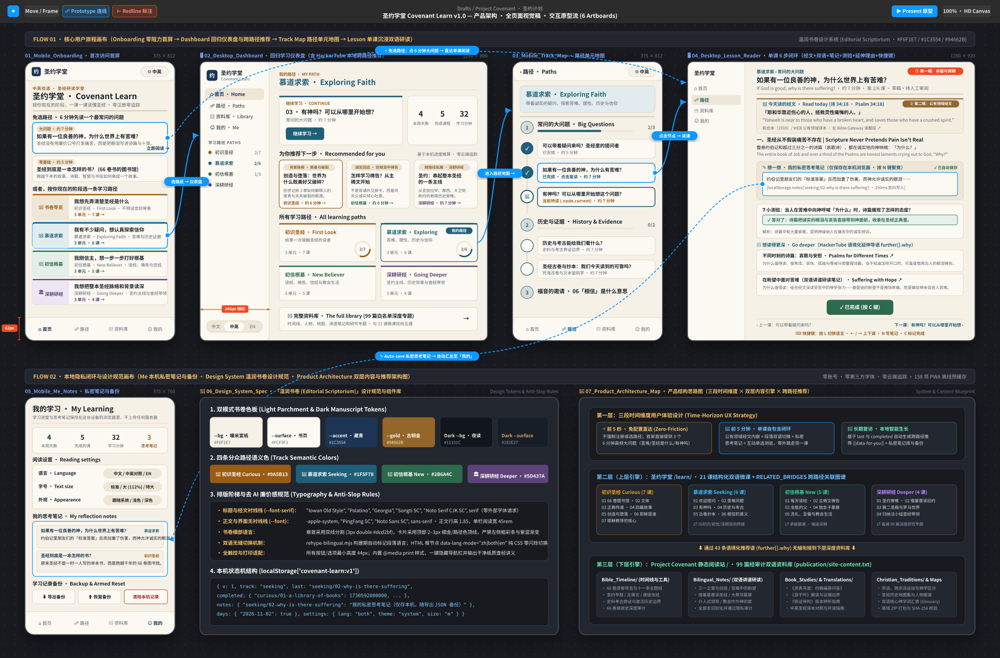

# Covenant Learn App | 圣约学堂应用

> Status: Draft (AI draft; not human reviewed) | 状态：Draft（AI 草稿，未人工审阅）

A responsive learning app (web + installable PWA) built on top of the Project Covenant library. It offers four learning paths: Curious, Seeking, New believer and Going deeper.<br>
在 Project Covenant 资料库之上做的响应式学习应用（网页＋可安装的 PWA），分为四条学习路径：对圣经好奇、认真思考信仰、刚开始信、扎根成长。

<a id="product-blueprint"></a>
## Product & UI/UX Blueprint | 产品结构与 UI/UX 全景设计图

The multi-artboard blueprint below summarizes the seven core screens, prototype interaction flows, Editorial Scriptorium design tokens, three-mode bilingual engine (`中文` / `中英` / `EN`), and local-first cross-path recommendation architecture.<br>
下方的多画板设计图汇总了七个核心界面画板、原型交互连线、「温润书卷」设计规范、三态双语切换机制（`中文` / `中英` / `EN`），以及纯本地跨路径推荐与双层内容架构。



<a id="quick-start"></a>
## Quick Start | 快速开始

```bash
cd app
npm install
npm run dev        # http://localhost:4321  本地预览，改内容即时刷新
npm run build      # 输出到 app/dist/，并生成离线用的 sw.js
npm run preview    # 预览构建结果
npm run check      # 类型检查
```

To build for a sub-path (for example GitHub Pages under the library), set `BASE_PATH`:<br>
如果要部署在子路径下（例如放在资料库网站的 `/learn/` 下面），设置 `BASE_PATH`：

```bash
BASE_PATH=/Project-Covenant/learn/ npm run build
```

<a id="editing-content"></a>
## Editing Content | 修改内容

See [CONTENT_GUIDE.md](./CONTENT_GUIDE.md). In short, each lesson is one Markdown file in `src/content/lessons/<track>/`, and each track is one YAML file in `src/content/tracks/`.<br>
详见 [CONTENT_GUIDE.md](./CONTENT_GUIDE.md)。简单说：一课一个 Markdown 文件，放在 `src/content/lessons/<路径>/`；一条路径一个 YAML，放在 `src/content/tracks/`。

<a id="structure"></a>
## Project Structure | 项目结构

```text
app/
  astro.config.mjs          构建配置（BASE_PATH、Markdown 双语插件、PWA）
  src/config.ts             应用名、资料库网址、经文阅读链接、路径顺序
  src/content.config.ts     内容字段定义与校验
  src/content/              ← 日常只需要改这里
  src/data/library.ts       “资料库”页的快捷链接
  src/lib/                  内容加载、双语标注、PWA 生成
  src/layouts/AppLayout.astro  外壳：手机底部标签栏 / 桌面侧边栏
  src/pages/                首页、路径、课程、资料库、我的
  src/scripts/              进度存储与页面交互（仅存本机）
  src/styles/global.css     全部样式（浅色 / 深色 / 字号）
  public/                   图标与 manifest
  scripts/sync-assets.mjs   构建前从 ../assets 复制插画和地图
```

<a id="design"></a>
## Design Choices | 设计取舍

- **Responsive:** phones get a top bar and bottom tabs; at 1024px and wider there is a sidebar. Reading columns are capped for comfort, and safe areas are respected for notched phones and standalone mode.<br>
  **响应式：**手机用顶部栏＋底部标签栏，1024px 以上切换为侧边栏；正文限制行宽，并适配刘海屏和安装后的全屏模式。
- **Bite-sized lessons** (5–10 minutes) on a visible path, with scripture, reflection questions, a quick check, and links into the full library.<br>
  **短课程**（5–10 分钟），排在清楚可见的路径上，每课有经文、思考题、小测验和延伸阅读。
- **Gentle progress:** a weekly day count instead of streak pressure. Missing a day costs nothing.<br>
  **温和的进度：**只显示“本周学习天数”，不搞连续打卡压力，漏一天不扣任何东西。
- **Private by default:** progress is stored only in the browser's localStorage. There are no accounts, analytics or remote fonts, and backups are exported and imported as files.<br>
  **默认私密：**进度只存在浏览器 localStorage；没有账号、统计或远程字体；可以导出/导入备份文件。
- **Offline:** after the first visit, every page and illustration works offline through the generated service worker.<br>
  **离线：**首次访问后，所有页面和插画都能离线使用（由构建生成的 service worker 负责）。
- **Store-ready later:** the static output can be wrapped with Capacitor. Before submitting to the app stores, add native features such as reading reminders and widgets so it passes App Store guideline 4.2.<br>
  **以后可上架：**静态产物可以用 Capacitor 打包；提交商店前要先加原生功能（读经提醒、小组件等），才能通过 App Store 4.2 审核。

<a id="relation-to-library"></a>
## Relation to the Library | 与资料库的关系

The app is separate from the publication pipeline in `scripts/`. It does not change the reading site, its allowlist or its single-script policy. Lessons link out to library pages via `LIBRARY_BASE_URL` in `src/config.ts`; check that URL once the site is live.<br>
应用独立于 `scripts/` 里的发布流程，不改动阅读网站、白名单或“只有一个脚本”的规定。课程通过 `src/config.ts` 里的 `LIBRARY_BASE_URL` 链接到资料库页面；网站上线后请确认这个网址。

[Content guide | 内容编辑指南](./CONTENT_GUIDE.md)
